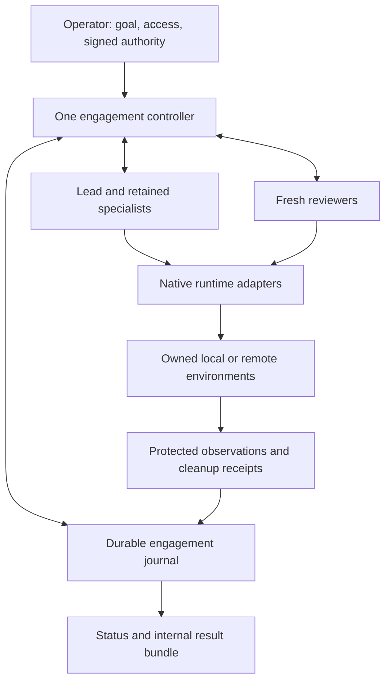

# OSLit: complete autonomous research engineering plan

**Status: implementation authorized, 14 November 2026.** The operator assigned
the full M0–M6 plan, native-tool reuse, enforced boundaries and real-workflow
verification. The fresh-target research test and native comparison remain
operator-owned. Implementation progress and evidence are recorded in
[the delivery record](oslit-implementation-2026-11-14.md).

The operator agreed with the plan's direction, including environment ownership,
and corrected two requirements: use Codex and OMP (oh-my-pi) as the intended
runtimes; allow research to continue while authorized and resourced, without an
arbitrary 24-hour ceiling. This revision incorporates those corrections. Exact
interfaces and policy migration still need M0's verification; endorsement of the
direction is not evidence that the design works or permission for a target run.

The operator subsequently approved task-local scored search and the minimal,
enforced native-tool integration described in
[Q30](oslit-harness-grilling-2026-11-13.md#q30--scored-search-within-a-task-minimal-native-tool-integration).
That record preserves the source evidence, alternatives and reasoning behind the
choice; the concrete interface below remains a design to verify.

This plan specifies implementation of the [30 operator decisions](oslit-harness-grilling-2026-11-13.md)
across runtime integration, research environments, coordination and recovery, and
usable delivery. It is grounded in source at
`89bcede2c1e62573767017251e8734f211fa3573`, plus the working-tree decision record.
It does not claim that the proposed team, integrations, or research advantage work.

**Test ownership:** the operator will provide the future fresh-target test. The
assistant is not assigned to select or run that test or the native-agent comparison.
Engineering verification below checks implementation behavior and remains separate
from that research acceptance. No implementation, provider call, target run, or
new-workflow E2E was performed while drafting this plan. Source inspection,
documentation research, CLI version/help readback, document checks and the existing
repository structural conformance command were used to check the draft.

The [November 12 foundation brief](oslit-research-foundation-2026-11-12.md) remains
historical. Its missing-handoff observations no longer describe all of this
checkout. This plan also updates the planning scope of the earlier
[agent-owned engagement specification](https://github.com/matheusht/redteam-harness/issues/201):
source, binary, and running-application access are required delivery capabilities,
and the team decisions apply. It does not rewrite that issue, old records, or
the [current draft source-engagement implementation](https://github.com/matheusht/redteam-harness/pull/209).

## 1. Recommended shape

Keep the existing engagement entrypoint and the useful execution controls. Give
new engagements **one durable team controller**, with native agents doing the
research and a small set of adapters handling runtime and laboratory differences.

- The lead owns the investigation: setup, hypotheses, priorities, specialists,
  experiments, connected effects, review responses, and the internal result.
- The controller owns task ownership, durable transitions, authority checks,
  required reviews, remaining resources, interruption recovery, and cleanup.
  It does not prescribe vulnerability techniques or a fixed sequence of experiments.
- Runtime adapters retain native tools and sessions. Environment adapters isolate,
  identify, stop, and inspect owned laboratories. Their execution receipts remain
  distinct from the controller's statements about them.
- The new route has one authoritative engagement journal. It does not stack a new
  scheduler over the existing driver and continuation state machines.
- Reusable research instructions ship independently of the harness mechanisms,
  so the operator can give the native baseline exactly the same methodology.

Retain Python and the standard library for the controller. Use existing Docker,
process, signature, and file-integrity mechanisms. Add no workflow service,
message broker, graph database, vector store, dashboard, or cross-engagement
learning system. There is one controller process per engagement, not a new
company-wide scheduling service.

### Where OSLit fits

OSLit supplies engagement-level behavior around the native agent runtimes:

| Layer | Responsibility | Reuse before building |
| --- | --- | --- |
| Model/provider | Inference, credentials, model availability and provider usage | The selected runtime's supported provider integration; no new universal model client. |
| Codex or OMP | Model/tool loop, context management, sessions, tools and native delegation | Native APIs, tools, extensions and lifecycle features. Keep useful native autonomy. |
| OSLit engagement | Durable research work, shared evidence, authority/resources across workers, independent checks, lab lifecycle and recovery | Existing repository controls, plus the smallest missing integration. |

A runtime is not a model endpoint. Using an OpenCode-supplied model credential
does not require running the OpenCode agent. Endpoint/authentication and tool-call
compatibility still depend on the selected runtime; provider independence is not
a claim that every model works through every runtime.

Before adding an OSLit mechanism, name the missing engagement behavior and check
whether the chosen runtime already provides it. Map native worker/session IDs to
engagement assignments; do not build a second intra-session scheduler, tool loop,
compaction engine or conversation store. If native delegation satisfies ownership,
usage and revocation requirements, use it. Add only the missing coordination or
enforcement. The portable journal preserves engagement facts across runtime loss
or replacement; it need not duplicate native session history.

### Why this shape

Two alternatives were developed from independent source traces. The first evolved
the existing entrypoint and consolidated its new-route state; the second placed
a new portable coordinator over existing execution boundaries. The first is the
base because it preserves the user entry and removes overlapping state owners.
The second contributes a strict rule: an effect reference points to a protected
executor receipt; a coordinator event never becomes proof of execution.

A new coordinator over unchanged child orchestration loops was rejected: the
current global turn lock and unknown-effect hold would still serialize unrelated
workers. A universal tool-call abstraction was also rejected: ordinary native
exploration should not become a host-approved task for every shell command.
These choices concern architecture, not evidence that the design improves research.

## 2. Current implementation: what is already present

The source links below are current-checkout anchors; the stated revision fixes
their meaning. Earlier saved test results are evidence for their recorded versions,
not new passes of this plan.

| Present mechanism | Observed behavior and remaining limit | Source |
| --- | --- | --- |
| Joined engagement driver | One initial signed scope already drives setup, proposal freeze, offline build, checked research, continuation, and closeout. It is not a missing phase handoff. | [driver](../../tools/native_engagement.py), `drive`, lines 586–751 |
| Full-engagement scope v1 | Host derives phase authority, but the schema requires source-only research, no impact demonstration, offline build, two exact model routes, and at most 24 hours. | [runner](../../tools/native_research.py), `_verify_engagement_scope`, lines 269–403 |
| Checked setup builder | Pins source, recipe, dependency catalog, build outputs, and cleanup. The catalog and image must be supplied before the run; build failure does not return to a general agent debugging loop. | [builder](../../tools/native_setup_builder.py), `setup_build`; [driver](../../tools/native_engagement.py), lines 660–712 |
| Continuation | Keeps a journal, lease, pending dispatch, session and a typed `NEXT.json`. This is one serial researcher, not a ready queue with specialists. | [continuation](../../tools/native_continuation.py), `_validate_next`, `_state`, `continue_run` |
| Native runtime | Pinned OpenCode configuration, session execution and reconstruction exist. Roles and model routes are fixed; web search, MCP and plugins are disabled in the candidate configuration. | [runner](../../tools/native_research.py), lines 93–160, `_native_exec`, `invoke_native` |
| Evidence and review | Frozen source actions, receipt adoption, fresh review packets, conditional patch checks, and result-version binding exist. Matching script output explicitly does not prove a security effect. | [continuation](../../tools/native_continuation.py), `_source_action`, `_agent_review`; [patch checks](../../tools/native_patch_check.py) |
| Cleanup and result | Closeout checks owner stop and resource absence. Its historical result explicitly leaves security effect unproven and grants no filing authority. | [closeout](../../tools/native_closeout.py), `_stop_and_readback`, `closeout` |
| Recovery | Unknown native effects prevent blind retry. Generic reconciliation is operator-driven; the automatic semantic reconciler is specific to a Kanboard role grant. | [continuation](../../tools/native_continuation.py), `reconcile`; [effect recovery](../../tools/native_effect_recovery.py) |
| Usage | Connections, bytes and duration are observed. `provider_request_count` and `monetary_spend` are absent, so these counters cannot establish total model usage or cost. | [runner](../../tools/native_research.py), `allowance_snapshot`, lines 3301–3329 |

The draft implementation reports provider-free and simulated checks; its final
joined scope-only scenario remains pending in the fetched PR description. The
[joined scenario](../../evals/native-qualification/JOINED-ENGAGEMENT-E2E.md) also
distinguishes its real offline build from simulated model, review, and owner work.
No live reliability, provider qualification, fresh-target result, or current hosted
CI pass is inferred here.

## 3. Operator workflow and delivery contract

The operator supplies the target access, goal, initial authority, available
infrastructure, and resource limits. Optional starting suspicions and directions
are recorded as input. A known vulnerability, target-specific build command,
prewritten experiment, dependency catalog, or expected positive answer is not
required.

Keep `python3 tools/native_engagement.py` as the public entry. The following
surface is **proposed**, not a list of commands already available:

```text
inspect   --inputs INPUTS                         # local preflight; no target effects
run       --inputs INPUTS --engagement-root ROOT   # start from initial authority
status    --engagement-root ROOT                  # goal, work, holds, usage, cleanup
direction --engagement-root ROOT --file DIRECTION  # record operator steering
resume    --engagement-root ROOT                  # recover existing work and limits
stop      --engagement-root ROOT                  # revoke work, reconcile, clean up
export    --engagement-root ROOT --output BUNDLE   # reviewed internal result + evidence
```

`inspect` verifies local input structure, signature/trust, installed adapter
versions, credential references, and available capabilities without contacting
the research target or invoking a model. `run` first creates a durable engagement
identity, then starts the lead. Network readiness checks and environment setup
happen only inside the authorized run. A failed preparation remains a setup
problem, not a security conclusion.

`direction` records the operator's words, provenance, time and affected work.
The lead can reprioritize without discarding earlier results. Directions that
would widen scope cannot change authority; unrelated authorized work can continue.
Status exposes which work was operator-steered. Status and export never start
research or repair state as a side effect.

Deliver a pinned installation manifest, a preflight command, three access-mode
input examples plus a combined-access example, a complete run/resume/stop guide,
and a result-bundle specification. The primary unattended execution host is an
operator-owned Linux machine with local durable storage; macOS with Docker remains
a development path. Long runs require an awake host. Supply a standard service-manager
example for restart after host/process loss, using `resume` and the same signed
authority, remaining resources and any operator-specified deadline. Do not require
a new custom daemon or cloud service.

Keep installation explicit: pinned repository revision, Python environment,
required environment images by digest, signing prerequisites, and per-adapter
binary/schema versions. Go/relay dependencies belong only to adapters that use
them; the old OpenCode transport is not a universal prerequisite. Extend the
current setup tooling and add
the new workflow guide at `docs/agents/engagement.md`; keep CI dependencies separate
from runtime prerequisites. Preflight checks these installed facts and identifies
missing credentials by reference without printing or copying their values.

The exported bundle contains the goal/scope identifiers, runtime/model versions,
methodology hash, operator directions, task and claim dispositions, sanitized
observations, controls, reproduction instructions, optional patch/diff checks,
unresolved leads, coverage limits, usage completeness, and cleanup readback.
Every referenced evidence artifact has a digest. No secret or private model
reasoning is required in the bundle.

## 4. One state owner and small integration boundaries



### Records and authority

| Record | Minimum content | Owner |
| --- | --- | --- |
| Initial contract | Goal, access identities, permissions, accounts by reference, permitted destinations/effects, infrastructure, cleanup rights, runtime/model choices, aggregate limits, revocation conditions and optional expiry | Operator-signed immutable input |
| Task | Research question, priority, prerequisites, affected resources, owner and assignment generation, state, result/evidence references, unresolved work | Controller commits lead/worker requests |
| Worker | Role, runtime/model/version, capabilities, workspace, native session, assignment and active/retired state | Controller owns assignment; runtime owns session observations |
| Knowledge submission | Author, observation/hypothesis distinction, source references, supporting and contrary evidence, correction/supersession links | Worker submits; controller publishes immutable version |
| Effect/resource reference | Intent and dispatch identity, actor generation, affected resources, authority reference, receipt identity, uncertainty and cleanup obligation | Controller owns admission; executor owns observed facts |
| Review | Exact packet/claim version, reviewer identity, observations, objection or disposition, required response | Reviewer content; controller ordering and version binding |
| Direction | Trusted operator origin, content, receipt and acknowledgment, affected tasks | Operator content; controller intervention record |
| Usage | Invocation identity, role/phase/model, measured quantities, source receipt, missing dimensions, reservations and settlement | Adapter/gateway observations; controller totals |

Use one host-owned append-only event journal for the new contract, with atomic
event-file publication and directory sync. One local process lease serializes
commits. Request IDs and expected revisions make retries return the existing
receipt. Replayed state and status snapshots are derived; snapshots can be
discarded and rebuilt. If a required event is missing, corrupt or out of sequence,
hold rather than invent a transition. Do not place the journal on shared network
storage or allow two hosts to coordinate the same root.

Workers can edit their own workspaces, submit requests, and read published
research state. They cannot write another worker's workspace, host control state,
protected receipts, or the canonical queue. Freeze referenced publication bytes
before committing their references. Research corrections append a new version;
they do not rewrite old evidence. Ordinary notes may remain editable, but no
accepted claim points at mutable bytes.

Validate and redact **before durable publication**, including runtime traces and
session-history retention. Keep provider keys and account secrets outside every
engagement plane; inject only the required ephemeral access through the authorized
runtime boundary. Capture structured, necessary observations rather than dumping
whole network bodies or conversations. If material evidence cannot be retained
without violating redaction, its claim remains unresolved. Export filtering is
an additional check, not the first secrecy control.

### Concrete module boundary

Names for new files below are proposed. Existing behavior is moved only when its
caller and preservation checks move with it; this is not a request for empty wrappers.

| Owner | Proposed responsibility and interface |
| --- | --- |
| `tools/native_engagement.py` | Existing public facade; select old/new contract once, implement operator commands and the narrow worker status/claim/submit interface below. |
| `tools/engagement_controller.py` | Consolidated new-route driver and continuation transitions: accept authenticated requests, atomically claim work, schedule eligible workers, enforce review obligations, recover and close. One journal. |
| `tools/engagement_contract.py` | Validate the new signed contract, messages and receipts; derive scoped worker/environment capabilities. Reuse existing signature and safe-path helpers. |
| `tools/native_runtime_codex.py`, `tools/native_runtime_omp.py` | Launch/resume/fresh context, deliver direction, observe completion/usage, revoke and read back runtime resources. Map native delegation into engagement assignments. Keep native wire formats private. |
| Existing builder/execution code, extracted into `tools/research_environment.py` where shared | Acquire permitted dependencies, prepare/inspect/reset an owned environment, dispatch protected replay, stop and read back resources. Local and SSH-backed execution use the same resource ownership contract. |
| Existing review, patch, and closeout modules | Build and validate evidence packets, bind dispositions to exact bytes, check patch provenance when requested, and verify cleanup. New-route orchestration belongs to the controller. |

The controller implements atomic claim, publication, worker-request and
review-request transitions. Publication, worker requests and review requests are
typed `submit` payloads in §5, not additional agent-facing tools. An executor returns a protected
`settled` or `unknown` observation; the controller cannot manufacture it from a
successful child-process exit.

For the new route, retain the useful invocation/receipt boundaries of the runner's
fixed-role `invoke_native`/`_native_exec` path, while using Codex/OMP's native
session APIs for execution. Extract shared controls only where callers need them;
an OpenCode runtime adapter is not a delivery prerequisite. Do not call the
unchanged global `continue_run` inside each worker. Its new-route scheduling, source-action adoption,
review response and closeout decisions move into the controller. The old driver
state, global turn lock, `NEXT.json` contract and continuation loop remain only
for their existing versioned route. A worker can still publish a next-test note;
that note is not a second shared task queue.

## 5. Runtime, model, and usage integration

### Selected runtimes and proposed interfaces

| Integration | Delivery proposal | Evidence limit today |
| --- | --- | --- |
| Codex | Native app-server over private stdio in an owned worker environment. Reuse sessions, turn control, tools and available native workers. | Host CLI reports `codex-cli 0.166.0`. Documentation/help establish an interface, not live integration. Pin the schema and effective capabilities in M0. |
| OMP (oh-my-pi) | Native JSONL RPC over private stdio. Reuse sessions, tools, task/wait delegation and worker control; map their identities and observations into the engagement contract. | Host reports `omp/18.20.0`; primary docs at tag revision `c308970263ae13744ea15ab67302e3dac840e266` describe these surfaces. No provider or live RPC check was run. |
| Providers/models | A configured set of available runtime/provider/model combinations, with credentials held by the appropriate host boundary. Lead chooses among the signed permitted set and records every role/model assignment. | Current free/paid DeepSeek tuples are compatibility entries, not the new architecture's complete model catalog. No new model/account availability is assumed. |

Supporting both runtimes does not require using both in every engagement. Select
the available, qualified backend for the work; no fixed runtime ordering is required.

OpenCode remains the runtime of the existing versioned implementation, not a
required new adapter. Preserve that route's meaning and checks. Its presence in
the code was the reason for the first draft's ordering, not a product requirement.
OMP's [provider map](https://github.com/can1357/oh-my-pi/blob/c308970263ae13744ea15ab67302e3dac840e266/docs/providers.md#additional-providers)
and local help explicitly support OpenCode Zen/Go credentials independently of
the OpenCode runtime. That does not establish the same provider route in Codex.

The official [Codex app-server documentation](https://learn.chatgpt.com/docs/app-server)
describes thread creation/resume, turn control and token-usage events. Use fresh
threads for reviewers, not a fork of the researcher's conversation. Pin the schema
generated by the selected CLI version. Prefer local stdio; avoid remote WebSocket
transport as a delivery dependency. A completed interrupt does not establish that
all child tools or target effects have stopped.

OMP's pinned [RPC specification](https://github.com/can1357/oh-my-pi/blob/c308970263ae13744ea15ab67302e3dac840e266/docs/rpc.md)
exposes steering, abort, sessions, subagent control and session statistics. A
`prompt_result` can precede background completion; check settlement before
recycling an environment. Cancellation alone is not durable authority revocation.
Pin effective settings as well as the binary: RPC defaults may differ from the
interactive setup. Its [native task runtime](https://github.com/can1357/oh-my-pi/blob/c308970263ae13744ea15ab67302e3dac840e266/docs/tools/task.md)
already supplies persistent workers and isolation options. Use those mechanisms
where they satisfy the engagement contract. The adapter must read back actual
session/resource state after interruption rather than infer it from missing events.

Each adapter must establish startup, ordinary tools, preserved context, fresh
context, model identity, direction delivery, usage, process/child inventory,
revocation and cleanup. Reuse native goal/continuation support where available;
the engagement controller owns recovery across runtime lifetimes, not a competing
turn loop. Unsupported features appear explicitly in the capability
report. A second adapter that only parses output does not establish portability.
An unavailable second runtime is an incomplete delivery item, not permission to
claim it is supported from a mock.

Native tools operate inside granted worker/environment capabilities. The host
does not require a research-task record for every read, shell call or browser
operation. Publish meaningful experiments, results, pending effects and handoffs.
Incomplete intermediate capture is allowed when authority and cleanup remain
enforced; decisive evidence still requires inspectable effects, controls and
independent reproduction.

The environment owner enforces network access independently of the native tool.
Use isolated worker networks with direct outbound access denied and separately
granted provider, acquisition, and target routes. Extend the existing relay/gateway
boundary to validate destinations and resolved addresses, recheck redirects, and
apply the signed protocol/destination policy; do not rely on proxy environment
variables alone. A native shell or downloaded tool cannot bypass this through a
direct socket. Remote workers require equivalent enforcement or report that
capability unavailable. Controller/runtime administrative channels remain outside
the worker's tool access. Record network policy separately from claims about the
semantic safety of an arbitrary HTTP request.

OSLit specialists cannot bypass lead-only creation through a native spawn tool.
Native delegation must either register children through the same role/usage/resource
boundary or be replaced by the scoped team operation for that role. Preserve other
useful native features. The operator's baseline keeps its normal delegation; it
does not inherit an artificial single-worker limit.

### Agent-facing tools: native first, three controller operations

Preserve native file/search/edit, shell/code execution, web/documentation, enabled
browser/debugging tools, job inspection/waiting, messaging and capability discovery.
Agents can obtain or build additional instruments in their granted environment.
Preflight reports effective capabilities and missing requirements; do not create
a duplicate tool registry or require every engagement to install every instrument.

OMP's pinned [task](https://github.com/can1357/oh-my-pi/blob/c308970263ae13744ea15ab67302e3dac840e266/docs/tools/task.md),
[write](https://github.com/can1357/oh-my-pi/blob/c308970263ae13744ea15ab67302e3dac840e266/docs/tools/write.md)
and [wait](https://github.com/can1357/oh-my-pi/blob/c308970263ae13744ea15ab67302e3dac840e266/docs/tools/wait.md)
interfaces cover native delegation, peer messages and incoming results. Codex has
[native subagent orchestration](https://learn.chatgpt.com/docs/agent-configuration/subagents).
Use the selected version's actual interfaces. Adapter RPC operations are host
controls; they are not automatically model-facing tools. Native personal checklists
also do not replace the engagement's shared ownership contract.

Expose missing engagement operations through the existing shell first. These are
illustrative commands extending the public facade, not installed commands:

```text
engagement status --since CURSOR
engagement claim
engagement submit --file SUBMISSION.json
```

| Operation | Behavior | Enforced boundary |
| --- | --- | --- |
| `status` | Own assignment, eligible work, relevant published changes, reviews, directions and evidence paths; returns a resumable cursor. Native reads/search inspect the referenced material. | Read-only view of the same journal; no implicit claim, dispatch or repair. |
| `claim` | Atomically claim eligible work from the lead-prioritized queue; return assignment identity/generation and resources. | Current authenticated worker, one owner, prerequisite and shared-resource checks; retries return the same receipt. |
| `submit` | Typed observation/artifact, follow-up task, task result, review response, or lead-only priority/assignment/worker/review/closure request. Return acceptance/rejection and durable receipt. | Validate the type, actor, role, assignment, authority, resource limits and immutable references; publication does not itself confirm a claim. |

The operator's commands in §3 and this worker view use the same state. Bind worker
reads to authenticated identity; return that worker's control state and authorized
published knowledge, not operator secrets or another worker's private runtime data.
The lead receives engagement-wide changes; reviewers retain Q17's full published
knowledge access. Operator steering uses the authenticated `direction` path, never
a worker submission claiming to speak for the operator.

Specialists may create follow-up work, claim ready tasks, publish and communicate;
the lead controls priority, assignments and team expansion. Reviewers receive fresh
context and full published evidence access, run their own checks and publish their
disposition. Only the operator changes signed authority. All engagement-state
mutations, through native integration or commands, reach the same controller
checks; there is no second task store. Ordinary workspace edits and exploratory
tools retain the capability-based execution described above.

Bind a request to its worker through a host-controlled channel and trusted runtime
identity. A submitted `role`, worker name or copied assignment ID is not proof of
identity. Reject stale/revoked generations at actual dispatch as well as submission.
Keep control files, hooks and parent credentials outside worker modification/access.
Guard alternate creation paths, pool helpers and direct model invocations, not just
the visible spawn tool. A peer message that wakes a retired worker must not restore
its authority or spend unreserved resources. Ordinary peer messages stay native;
consequential assignments and research directions require durable controller acceptance.

Native workers sharing a process may not expose a trustworthy per-worker identity
or permission boundary. Verify that in M0/M2. If needed, use separately owned runtime
sessions/processes while retaining their native tools; otherwise mark that capability
unsupported. A role prompt is not isolation. If CLI transport proves inadequate,
expose the same handler through a native host tool; add no parallel implementation
or required MCP service. For each operation document its purpose, when to use it,
invocation, resulting evidence and the narrow conclusion the receipt supports.

### Aggregate usage and long operation

Record every setup, lead, specialist, reviewer and recovery invocation once.
Normalize usage from runtime/provider observations, not agent-written estimates.
Keep input/output/cached tokens, request counts, wall time, relevant laboratory
resources and billed/estimated monetary values distinct. Record price/version
when reporting an estimate; do not label it an invoice. A restart, duplicated
event, model switch or adopted late receipt cannot reset or double-count usage.

Reserve shared capacity before concurrent dispatch and settle it from receipts.
Unknown in-flight use remains reserved conservatively. When a hard dimension
cannot be bounded or measured reliably, mark that capability/limit unsupported;
do not claim an enforced total from an incomplete counter. Informational missing
cost can remain unknown. OMP's installed `--max-cost` help explicitly allows
in-flight requests to finish above its threshold; it is not by itself a strict
engagement spending cap. Reuse such native controls but verify their semantics
before treating them as an enforced outer limit. An exported comparison
configuration must say which limits were actually enforced and which usage
dimensions remain incomplete.

The new contract has **no fixed engagement lifetime and no mandatory deadline**.
Research may continue for days or longer while its authority is valid, resources
remain, and the goal still requires work. Honor an operator-specified deadline
when present. End on verified goal completion/reviewed closure, operator stop,
authority loss or resource exhaustion; preserve unresolved work and exact blockers.

Short worker invocations and laboratory leases are renewable inside that grant.
Their expiry fences disconnected or failed workers; it does not declare the
investigation finished or require new operator approval every day. The controller
checks current authority, remaining resources and any explicit deadline at admission,
dispatch and lease renewal. A disconnected worker loses capability when its lease
expires. Restart or lead replacement preserves consumed resources and revocations;
neither creates a new allowance. Cleanup uses retained cleanup authority and never
reactivates research.

This is a v2 policy change across the whole execution path. Today's 24-hour checks
remain in `_verify_engagement_scope`, plan/setup/live approval validation,
`native_engagement.py`'s phase-duration clamp, and the pinned `native_run.py`
owner. M0/M1 must reconcile each with v2 renewable leases and optional overall
expiry while preserving v1 behavior; raising one timer cannot deliver multi-day work.

Multi-day runtime resilience needs an actual sustained engineering soak, including
restart and resource readback; accelerated clock checks alone cannot establish it.
That soak exercises a harmless controlled workflow, not the operator's fresh-target
research test. Do not publish a multi-day research claim from it.

## 6. Agent-owned environments across all access modes

Setup becomes an iterative research task: inspect available access, obtain tools,
prepare an owned environment, check normal behavior and permissions, diagnose a
failure, then revise the setup. The host validates effects and records provenance;
it does not supply a target-specific build recipe. Preserve the agent-written
initial threat model and evidence-linked corrections as research aids. They are
not permission or a fixed research itinerary.

Separate internet acquisition from target-effect authority. Downloading public
documentation or dependencies under the acquisition policy does not authorize
testing those services. Record URLs without credentials, versions/digests, install
commands, relevant patches and environment identity. Run acquired code inside
the authorized lab. Retain the offline catalog as an optional reproducibility or
restricted-network route rather than a universal prerequisite.

| Access supplied | Required behavior | Identity, reproduction and cleanup |
| --- | --- | --- |
| Source | Inspect build/configuration, fetch permitted dependencies, build/debug setup, start services if useful, create instruments, test original and disposable working copies. | Preserve original revision/content separately from setup edits and proposed fixes. Keep checked-build receipts and executable setup instructions. |
| Binary | Identify artifact/platform, obtain analysis/debug/fuzz tools, choose an appropriate local or remote execution environment. No fabricated source tree or required build command. | Bind evidence to exact binary, loader/libraries, architecture, starting privileges and execution conditions. Unsupported hardware/privileges are explicit blockers. |
| Running application | Use authorized endpoints/accounts, learn normal and denied behavior, inspect observable state, and arrange repeatable starting conditions where available. | Prefer separate instances/accounts. When cloning is unavailable, coordinate affected state, establish reset/readback and record reproducibility limits. A local clone does not silently prove an effect on a remote deployment. |
| Combined access | Use whichever source, binaries, services and observations answer the current question. | Record which deployed/build versions correspond; a source hypothesis must be linked to the actual tested artifact or service. |
| Optional remote lab | Run on a provided authorized Linux/SSH host; agent sets up owned directories, containers, tools and jobs. | Pin host/account identity, resource IDs, initial state, capabilities, worker lease, any engagement deadline and cleanup readback. No broad cloud-IAM provisioning framework. Missing infrastructure remains a specific blocker. |

The remote implementation uses ordinary SSH and the existing container/process
boundary on the authorized host. Bind each remote job to a run-specific directory
and bounded lease that can expire even if the controller connection disappears.
An expired lease is not proof of cleanup: reconnect and read back the exact
resources. Reuse an existing host only after identifying ownership; never terminate
unrelated processes or wipe pre-existing data.

Allocate specialist workspaces and target instances lazily. Independent instances
can proceed concurrently. Tasks sharing non-copyable state take a resource lease
for incompatible changes. If the environment cannot enforce narrower separation,
allow only one write-capable worker on that target/account/state at a time; a task's
self-declared dependencies are insufficient. Bind actual shell/browser/service
access to that lease, and keep dependent-state holds until uncertain effects are
reconciled. Independent source work or separate instances can continue. The lead
can intentionally bring results into the same
instance to test a chain. Isolation must support connected experiments, not prevent
them. A recorded task completion requires its outcome/evidence or exact remaining
limit, not simply a finished model turn.

## 7. Research coordination, review, and recovery

### Research remains model-directed

The lead turns the goal into research questions and prioritizes the strongest
evidence-backed path. Specialists claim ready work from that prioritized queue;
atomic assignment gives each task one accountable owner. They choose their own
experiments, follow calls and interactions across boundaries, and build instruments.
They can publish follow-up questions and ask for help; only the lead creates agents.

Retain specialist context while useful. Reassignment preserves scripts, results,
working explanations and unresolved effects. Shared knowledge belongs to the active
engagement. Cross-engagement memory, changes to shared/acceptance evaluators and
automatic promotion of reusable tools remain deferred. Task-local instrument
creation and revision follow Q30 below.

A low-severity effect can open a deeper path. Preserve its supported conditions
while testing whether they compose with another effect under compatible starting
permissions and state. Separate successes do not prove a chain. There is no required
finding count, depth count, permanent worker roster, or fixed vulnerability taxonomy.
The initial suspicion is a hypothesis, not a positive answer to manufacture.

### Shared knowledge, updates and instruments

Provide a searchable board derived from the existing journal and published
artifacts: questions/owners, observations and contrary evidence, unresolved work,
and reusable instruments. It is a view, not another mutable whiteboard service.
Retain author, source, tested conditions, verification state and correction links.
Treat target-derived content and peer claims as data, never as new authority or
instructions that override the engagement. A summary cannot replace its evidence.

Deliver concise relevant changes through native messaging/steering, with stable
event references. A durable per-worker cursor lets `status` recover missed changes
after a crash or context reset; duplicate notices do not repeat a mutation. Return
bounded pages and an explicit continuation cursor instead of silently dropping
updates or inserting the whole board into every turn. Authorization/reassignment
enforcement never depends on the model reading a notice. Native waiting handles
idle workers; no busy polling loop or new message broker is required.

Sharing does not oblige every worker to adopt the current favored explanation.
The lead can retain competing investigations or request an independent first pass.
Reviewers start from the exact claim packet, including contrary evidence, with
full published knowledge available for inspection. Do not automatically inherit
researcher conversations or team popularity rankings; verify native history access
and context initialization rather than assuming a fresh role name ensures this.

Publish reusable scripts, setup recipes and probes by immutable content reference,
with dependencies, environment identity and operating conditions. Another worker
copies/installs a selected version in its own granted lab. Corrections publish a new
version; a shared mutable tools directory cannot change an earlier experiment.
Reviewers may reuse an instrument but independently check its measurement.

### Scored search within a research task

An agent may implement a local evaluator when it helps answer a question, using
native shell/code tools. It defines the metric, relevant constraints and reset
conditions, and retains candidates, measurements and decisive artifacts. The lead
can assign parallel candidate exploration within the existing team/usage rules.
This creates no permanent optimizer service, mandatory `evaluate` tool or global
ranking. Scoring is optional; poorly measured but important questions remain valid.

Bind results to the evaluator version, candidate bytes and environment conditions.
Agents may revise an inadequate instrument, but record the new version and rerun
relevant candidates before comparing scores; do not overwrite previous results
or compare different metrics as if they were one. An improved score can choose
the next experiment, not establish a security effect or alter the engagement's
acceptance rules. Confirmation still requires effect/control/independent replay.
This is task-local adaptation, not promotion of a shared evaluator or methodology.

### Example: a lead follows an unexpected path

This is an illustrative investigation, not an observed run, selected acceptance
target, or instruction to test a service. Suppose the operator supplies source,
a disposable application instance, a low-privilege account, and permission for
benign execution markers. The goal is to determine whether that account can cause
server-side execution. The starting suspicion concerns document uploads.

1. **Frame the question.** The lead reads the application and observes that uploads
   enter a background conversion job. It asks a specialist which user-controlled
   values survive into that job, and another what privileges and inputs the job
   actually uses. These questions come from the observed program, not a preset
   upload-to-RCE checklist. Each task gets one accountable owner and an isolated
   workspace; a small question can stay with the lead.
2. **Investigate freely.** The first specialist traces code and adds an instrument
   to its lab. Its original parsing hypothesis fails, but it observes an unexpected
   influence on an output path. It publishes the tested conditions, contrary result
   and artifact references. It can follow that lead within its assignment or ask
   the lead to prioritize a larger question; it needs no task ticket for every read
   or shell command and cannot create its own extra team.
3. **Connect evidence.** The second specialist finds a privileged worker consumes
   a generated artifact. The lead considers whether the first observation can
   affect that worker, then asks for a joint experiment in one resettable instance.
   The two observations remain separate claims until an experiment connects them
   under the same starting permissions and state. The lead can redirect the team
   away from the original upload hypothesis.
4. **Challenge the result.** A fresh reviewer checks a reported benign marker and
   discovers the setup accidentally used an administrator account. The claimed
   low-privilege effect is unsupported. The lead corrects the setup and repeats
   the relevant experiment, or records why the evidence supports another conclusion.
   The reviewer supplies a concrete objection; code does not choose a winning
   hypothesis by counting model votes.
5. **Continue across days.** A useful experiment spans a context reset or a host
   restart. Native sessions retain what they can; the engagement records preserve
   the question, tested conditions, scripts, evidence, remaining allowance and
   unknown effects. A finished background job is read back before any retry.
   Independent work can continue. Passing 24 hours supplies no reason to stop.
6. **End for a reason.** If fresh reproduction and its control establish the
   bounded objective, close it after review and cleanup. If the goal was a broad
   security investigation, retain this result and pursue the remaining material
   paths. If authority/resources end, export the supported observations and
   unfinished work; a failed path never becomes a universal absence claim.

The models choose the questions, instruments, explanation and next experiment.
OSLit makes assignments, evidence, limits and recovery dependable. The queue is
shared work with ownership and prerequisites; it is not an encoded research strategy.

### Required challenge without a permanent supervisor

The controller records a review obligation when the record supplies a concrete
reason: repeated materially identical experiments without a new discriminator,
an unresolved contradiction relevant to the chosen path, strong-lead dismissal,
or proposed closure. A specialist can submit the evidence for such an obligation.
These signals request fresh judgment; they do not establish that research failed.
No timer, token threshold or message count alone establishes stagnation.

The lead creates the fresh strategy reviewer. It receives the goal, exact issue,
supporting and contrary evidence, prior experiments and full knowledge-base access.
It must identify an overlooked condition, competing explanation or useful
discriminating experiment. The lead acts or gives an evidence-backed rebuttal.
A substantive disagreement stays explicit and can be tested; agreement between
models is not the criterion for progress or truth.

Proposed initial meaning of **repeatedly ignoring review**: the same actionable
obligation is delivered at two completed lead decision checkpoints, with a genuine
opportunity to respond, and neither an action nor an evidence-backed response is
recorded. A running long experiment, absent findings, a process crash or reasonable
disagreement does not count. A disputed response receives fresh evidence review;
the controller cannot decide its validity from keyword matches.

If the lead never creates the requested reviewer, the recovery evidence is the
frozen triggering observations, delivered review requests and two recorded
opportunities with no action or substantive response. The controller can use Q27's
lead-replacement exception for that observable nonresponse; it does not invent a
review verdict about the investigation. The replacement lead must create the
pending reviewer before the affected research direction resumes. If the old lead
has supplied a substantive disputed explanation and no reviewer exists, that is
not a nonresponse: retain the obligation and hold the affected direction until
fresh review is arranged. Independent work can continue. This concrete rule is
proposed engineering policy and must be checked for false replacement; it is not
a proven metric or an exception allowing specialists to create reviewers.

Replacement is a durable sequence: record intent; revoke the old lead's generation
and worker-creation rights; interrupt and stop its owned runtime/tool processes;
reconcile or hold its in-flight effects; verify revocation; then grant the new
lead a new generation. Keep unaffected specialists running. The new lead receives
the goal, scope, directions, queue, evidence, open reviews, resources and remaining
allowance. At most one lead can act. Delayed output from the old lead can be retained
as evidence but cannot change assignments or issue new work.

Changing a field in the queue is insufficient revocation. The same generation
must be checked at actual dispatch, and old shells, browsers, native children,
network routes and remote jobs must lose their authority. If an adapter cannot
establish this, it cannot offer autonomous replacement for that capability. Hold
the affected work rather than start two acting leads.

### Unknown effects and independent progress

Reuse write-ahead dispatch intent and protected terminal receipts. A restart
adopts a matching completed receipt once; it never repeats a request merely because
the controller did not receive its result. Reconcile using the owning environment
or instrument's observable state. Preserve uncertainty when no trustworthy readback
exists; there is no generic semantic oracle for arbitrary target changes.

Hold the affected task and every task depending on the same uncertain state.
Unrelated instances continue. If intermediate actions were not fully captured,
conservatively treat that worker's authorized resource set as affected until
readback narrows it. Task-lease expiry alone does not permit reexecution. Failed
isolated labs can be repaired/recreated after their effects and cleanup are known.

### Claims, review and closeout

Keep three separate states: **claim** (unconfirmed, supported, independently
confirmed, refuted, needs review), **search** (active, blocked, deferred, reviewed
complete), and **cleanup** (pending, verified, unresolved). A finished task or
stopped owner is not a confirmed security claim.

An independently confirmed internal claim needs the actual attacker permissions
and preconditions, decisive execution observation, a causal control, and clean
independent reproduction. The reviewer may reuse instruments, but checks their
measurement and assumptions and builds another probe when needed. Packets bind
exact claim, original inputs, supporting/contrary observations and unfinished work.
Material edits invalidate only affected conclusions and require fresh review.

Add these claim dispositions in the new contract; do not relabel old source
execution or `complete_internal_candidate` receipts. The internal result distinguishes
goal met, reviewed bounded negative, and incomplete/blocked work. It preserves
unexplored paths. A broad investigation does not end at its first finding; a bounded
goal can end after verification and review. Neither implies universal target safety.

When patching is in the goal, reuse original/patched byte binding, effect/control,
normal-function and relevant variant checks. Other goals need no patch. Closeout
binds the final result to current reviews, reconciles effects, stops owned work,
and verifies actual cleanup. Stop, expiry and resource exhaustion preserve an
incomplete result promptly rather than wait for a reviewer to permit stopping.
Filing, disclosure, publication, deployment and merging remain external actions.

## 8. Initial authority: the explicit policy change

Propose a new versioned `native-engagement-scope-v2` and an accepted ADR before
enabling its broader authority. Reuse signature verification and immutable inputs;
do not reinterpret a v1 signature. The new contract names access identities,
permitted actors, environment capabilities, network destinations/classes, model
assignments, resource ceilings, allowed internal effect classes, escalation ceiling,
artifact obligations, cleanup authority, revocation and optional expiry. Unknown facts remain
unknown; a threat-model note or agent request cannot widen these fields.

| Current rule | Proposed new-route behavior | Preserved boundary |
| --- | --- | --- |
| Source-only v1 scope; offline setup/build | Initial authority can permit agent-owned acquisition, setup and the supplied access modes. | Every effect fits the signed environment and resource boundary. |
| Fresh human confirmation for each Zone-2 artifact | Explicitly preauthorized, bounded artifact classes can be created within the signed lab; record exact artifact and cleanup obligation at creation. | Unlisted or unenforceable effects stop for authority; vague permission does not qualify the mechanism. |
| Operator review before each escalation rung | Fresh independent evidence review can authorize the next **already signed** internal rung after the preceding effect succeeds. | No automatic scope/account/environment expansion; no narrative-only escalation. |
| Fixed model tuple and 24-hour ceiling | Signed allowed assignments and resource limits; optional operator deadline, renewable short worker leases and complete shared accounting. | No refresh of authority or allowance from restart, replacement or phase transition. |
| External-action gate | Unchanged. | Internal acceptance is not filing, disclosure, publication, deployment or merge authority. |

This change must reach root `AGENTS.md`/`CLAUDE.md`, the native/bootstrap guides,
the new scope validator, runtime/environment admission and relevant failure checks
together. Existing safe-signal requirements for loaded cards, redaction and immutable
history remain. The current gates stay active until the new policy is explicitly
approved and its corresponding controls are verified and adopted. Plan approval
is not itself a signed research engagement or an external-action grant.

## 9. Keep, simplify, replace, delete

“Delete” below means remove redundant code or requirements from the **new default
path after callers move**. Historical records, fixtures and supported old contracts
are retained. No deletion is performed by this document.

| Disposition | Concrete surface | Planned treatment |
| --- | --- | --- |
| **Keep** | `operator_signature.py`, current private-file/path checks and scope binding | Reuse one authority implementation; add versioned v2 validation rather than a second signature scheme. |
| **Keep** | Driver pending-action recovery, source-action freezing/adoption, checked-build manifests | Extract their useful transition/receipt semantics into new-route owners; preserve v1 meaning and evidence. |
| **Keep** | Native session resume and workspace reconstruction | Place runtime-specific operations behind adapters; material handoffs remain independent of native conversation history. |
| **Keep** | `native_patch_check.py`, fresh reviewer packet binding, original/modified separation | Extend to new claim/resource identities without weakening causal checks or making patches mandatory. |
| **Keep** | Owner revocation, resource identity, stop and cleanup readback | Extend to every worker and remote resource; never replace readback with a status string. |
| **Keep** | Legacy queue/kernel readers and historical capture fixtures | Existing engagements stay on their route. No conversion, regrading or fallback from a failed new run. |
| **Simplify** | `native_engagement.py` plus `native_continuation.py` new-route orchestration | One controller/journal. Retain phase/effect receipts without maintaining two copies of team state. |
| **Simplify** | `engine/native-research-workflow.md` and native setup instructions | Separate portable research method from runtime handoff syntax; preserve hypotheses, chaining, controls, review, threat-model corrections and stop rules. |
| **Simplify** | Bootstrap and public inputs | One new access-aware entry; source-only bootstrap/Pi pointer delegates or explicitly selects the historical source route. Operator supplies authority/access, agent supplies setup choices. |
| **Simplify** | Fixed reviewer/target containers | Allocate needed workers, reviewers and target instances lazily; retain useful specialist sessions. |
| **Replace** | Runner model/provider constants, `_model_config`, gateway route assumptions and loaded-tool restrictions | Qualified runtime/provider configurations and role capabilities, updated together with transport and usage checks. Keep old exact tuples for old runs. |
| **Replace** | Global role list/turn lock and canonical single `NEXT.json` | Authenticated worker identities, per-assignment generations, atomic ready-task claims and resource coordination. Per-worker native serialization remains where needed. |
| **Replace** | Mandatory supplied offline catalog/image and fixed failed-build ending | Authorized acquisition and agent repair loop; offline catalogs remain an option. |
| **Replace** | Global unknown-effect hold and operator-only generic recovery | Resource/dependency-scoped holds and automatic trustworthy readback where available. Unknown remains held when it cannot be resolved. |
| **Replace** | Transport-only allowance as apparent whole-run accounting | Shared observed usage/reservations across all phases and roles, with explicit missing dimensions. |
| **Delete from new core** | Embedded Kanboard/T01/S10 target-specific branches | Move/retain them behind their historical capture route; generic control does not import target names or fixed flaw recipes. |
| **Delete from new path** | Duplicate state projections treated as authority, mandatory phase approval files inside v2, manual closure-file handoffs, dormant preallocated roles | Move callers first, prove preservation, then remove the duplicate path. Do not carry the old source restrictions into a nominally general route. |
| **Do not add** | Fixed swarms, technique scheduler, universal observer, cross-engagement learner, cloud provisioning framework | No requirement justifies them. Agent-created instruments inside one engagement remain supported. |

The caller inventory includes `native_research.py`, `native_setup_builder.py`,
`native_continuation.py`, `native_engagement.py`, `native_closeout.py`,
`native_patch_check.py`, `native_provider_gateway.py`, the pinned native-run/stop
and CONNECT controls, Docker runtime setup, bootstrap/Pi pointers, root/native
guides, workflow instructions, smoke scenarios, schemas and CI wiring. Update
`CONTROL_SHA` and other integrity pins only with their reviewed source and evidence;
never remove pin checking to make a refactor pass.

## 10. Implementation sequence after plan agreement

These are integration milestones, not a reduced MVP. Full engineering delivery
requires all access modes, both proposed runtime adapters, team behavior, recovery,
usage, documentation and handoff. Research qualification remains the operator's
later work.

| Milestone | Work and dependency | Exit artifact |
| --- | --- | --- |
| M0 — Contracts before code | Resolve the proposed ADR and v2 boundary; specify status/claim/typed-submit, actor attribution, update cursors, ownership and claim states. Inspect exact native role/spawn/history capabilities and versions before choosing enforcement boundaries; define failure scenarios and provider prerequisites. | Approved design/contracts, native reuse/gap map and runnable-scenario specification; no altered old authority. |
| M1 — One new state owner | Extract existing effect/runtime primitives, add v2 journal/replay, shared reservations/settlement and facade routing; carry one researcher through existing source setup/execution/review/cleanup. Remove competing v2 driver/continuation ownership. | Public-workflow receipt with old-route readback, crash/adoption and limit-exhaustion cases; honest simulation labels. |
| M2 — Real runtime boundaries and team work | Codex/OMP native reuse with the minimal worker interface, authenticated assignments, atomic claims, protected per-worker execution and journal-derived updates. Enforce alternate spawn/wake paths. Shared reservations and unknown-use holds precede concurrent dispatch. | Real harmless runtime control/reconstruction checks; queue, lost/duplicate update, spoofed-role, limit and handoff scenarios. |
| M3 — Complete environment loop | Authorized acquisition, setup repair, all access modes, isolated/shared resources and SSH-backed labs. Enforce shared-target write leases; publish versioned instruments and setup conditions. | Repeatable setup/cleanup manifests, shared-target conflict and remote-loss cases. |
| M4 — Evidence, strategy review and replacement | Evidence packets, independent measurement validation, task-local scorer/instrument provenance, strategy obligations/rebuttals, lead revocation, conditional patch review and goal-sensitive closeout. | Reopen, disagreement, false score, changed instrument, ignored-review, stale-lead and cleanup-failure artifacts. |
| M5 — Accounting completeness and long operation | Complete provider reporting and whole-workflow reconciliation on the already enforced shared limits; exercise optional deadlines, no-deadline continuation past 24 hours, service restart, delayed receipts and multi-day controlled soak. | Reconciled usage report and observed restart/soak results; unsupported dimensions explicit. |
| M6 — Usable delivery and retirement | Install/preflight, examples, operator guide, evidence export, reusable instruction bundle, CI and caller migration; remove redundant new-route paths only after parity. | Versioned release candidate and handoff with engineering evidence, remaining limits, and no research-acceptance claim. |

M2/M3 development can proceed in parallel after their M0/M1 interfaces are stable;
the coordinating implementer owns final integration. Use one writer per changed
module. A missing adapter or failed environment branch is an unfinished milestone,
not a reason to silently narrow the final requirement to source-only work.

Existing source-engineering tickets overlap M1 and parts of M4; reuse their work.
Do not close or replace tickets based on this plan. Reconcile any future tracker
updates with the completed code and evidence when separately authorized.

## 11. Failure-first engineering verification

Write the concrete failure inputs, expected observations and public-workflow
scenarios **before implementation**. Prefer E2E checks; do not add unit tests after
writing code. Existing preserved checks remain useful at their stated boundaries.
The table is the scenario specification to expand, not a claim of tests run.

| ID | Workflow and failures to exercise | Required observation/artifact |
| --- | --- | --- |
| E01 | Invalid/changed/expired scope, wrong signer, path/symlink escape, malformed/duplicate request, forbidden model or effect | Refusal before dispatch; preserved reason and unchanged authority. Old inputs retain old behavior. |
| E02 | Fresh source setup, missing dependency, failed build, agent repair, changed recipe/source, acquisition outside policy, direct-tool egress bypass and redirects/resolution outside granted routes | Agent repairs inside authority; host rejects prohibited network effects independently of tool cooperation; exact provenance/readiness and no operator build hints or false security result. |
| E03 | Binary/application/combined inputs; wrong architecture, role or version; non-copyable target with concurrent shell/browser writes and stale lease | No source prerequisite; correct environment or precise blocker; actual conflicting writes denied before effects; isolated work continues; reproduction limits remain explicit. |
| E04 | Racing claims, forged actor/role, typed-submit misuse, native alternate spawn/pool/direct-model route, reassignment, late output and message revival of retired worker | One owner and authenticated role; denied bypass before dispatch/spend; no stale revival or authority change; follow-up work still allowed. |
| E05 | Model/session loss, retained specialist, missed/duplicate/out-of-order notices, paginated update backlog, native reviewer history leakage, adapter change | Durable cursor recovery without repeated effects or silently lost contrary evidence; fresh reviewer with full published evidence; actual feature limits explicit. |
| E06 | Crash before/after dispatch, completed receipt lost to controller, unknown effect, dependent and independent labs | Adopt once; no blind repeated effect or charge; hold affected dependencies while independent work continues. |
| E07 | Remote disconnect, controller/owner restart, job outlives connection, wrong host/resource identity, failed cleanup | Bounded remote authority, exact readback and retained obligations; no false cleanup or unrelated process removal. |
| E08 | Repeated uninformative experiment, material contradiction, valid rebuttal, ignored review, refusal to create reviewer, long productive experiment, reasonable disagreement | Evidence-triggered challenge; distinguish documented nonresponse from disputed explanation; replacement lead fulfills pending review before affected work; no stagnation verdict from time/tokens. |
| E09 | Replace lead during active shell/browser/child/remote work; delayed requests from revoked generation | Actual capability revocation before replacement; one acting lead; uncertain effects held; other workers preserved. |
| E10 | Convincing false success or high score, wrong permission, flawed reused instrument, changed scorer/metric/state, omitted contrary evidence, changed claim, clean control/replay | Score remains local feedback; incomparable results are separated; instrument versions and raw evidence survive; reviewer validates measurement; material changes invalidate affected review. |
| E11 | Bounded goal met, broad goal with first finding and unfinished paths, reviewed negative, rejected closure, user stop, expiry | Goal-sensitive continuation/ending, concrete reopen, prompt stop and cleanup; no absence-of-vulnerability inference. |
| E12 | Requested patch, mismatched diff/bytes, altered probe, regression; research goal with no patch request | Same effect/control and normal-function checks on original/patched bytes; independent review; no mandatory patch for other goals. |
| E13 | Concurrent usage, duplicate/missing/delayed receipt, model switch, retry, exhaustion during setup/review, multi-day restart, no-deadline run beyond 24 hours, explicit expiry and disconnected worker lease | One total, no reset/double charge; authority/budget allow long continuation; explicit expiry and lease loss revoke capabilities; measured/estimated/unavailable values distinct. |
| E14 | Operator direction, forged operator message in shared notes, target-derived instructions, peer disagreement, request to expand scope, revised threat-model assumptions | Trusted steering recorded separately from peer content; observations do not become authority or consensus proof; in-scope priorities change with history preserved. |
| E15 | Secrets in output/artifacts, mutable/shared instrument references, changed publication bytes, corrupted journal/snapshot, export omission, old readback | Redaction before persistence; versioned instruments and immutable evidence; corrupt/missing evidence stays incomplete; export verifies references; no history conversion. |
| E16 | Clean operator install/inspect/run/status/resume/stop/export plus worker status/claim/submit and native messaging/waiting; both runtimes/all environment modes | Documented minimal interface works with actual caller binding; native reuse is verified; local, simulated, provider and unverified capabilities remain distinct. |

Proposed scenario entrypoint for the implementation phase:

```text
python3 evals/native-qualification/smoke/check_engagement_team_e2e.py
  --scenario E04 --output /private/checks/E04/result.json
```

Each scenario package records its exact command, input manifests, environment and
runtime versions, required accounts/services, expected statuses, observed receipts,
sanitized logs, scope/claim hashes, and cleanup. Provider-free scenarios use
explicitly labeled simulated agent events; real harmless runtime checks verify
native control and tools. A real local/remote environment check must read back
actual resources. Missing access yields an unavailable result, never a simulated
pass presented as live proof. No synthetic vulnerability or planted challenge
substitutes for the operator's test.

Wire the relevant public-workflow checks into the existing CI configuration after
their prerequisites are explicit. Keep structural conformance and historical
reader checks. Report local checks, native/provider behavior, remote behavior,
hosted CI and operator research acceptance separately. Stop repeating checks once
the affected evidence is sufficient and no new change or failure calls for rerun.

## 12. User-owned research acceptance handoff

Deliver the machinery and evidence format needed for the operator's future test,
not an assistant-run benchmark project. Do not choose fresh targets, launch the
comparison, tune the harness to a disclosed flaw, or claim the test has happened.

The handoff preserves the agreed criteria:

- Same reusable research instructions, model, target, goal, initial directions,
  access, infrastructure and generous total limits; record actual use separately.
- Native baseline retains its ordinary tools and delegation. It does not install
  OSLit's coordination/recovery implementation. Mixed-model experiments remain separate.
- Fresh unrelated real targets cover source, binaries and running applications;
  the first supplied target begins that evidence, rather than proving every class.
- Preserve every start, failure, negative and incomplete result, false claim,
  human intervention and cleanup limit. Human assessment occurs after the
  autonomous investigations. Later directions change the autonomy label.
- Research acceptance still needs an independently reproduced real finding or
  chain and improvement beyond the native agent with the shared instructions.
  A dry target need not contain a vulnerability, and engineering passes cannot
  supply missing positive or comparative evidence.

Export the pinned instruction bundle and neutral run metadata without supplying
target-specific research steps. The operator decides the test configuration and
owns execution and assessment. Requirements here do not authorize the assistant
to perform it later without a new assignment.

## 13. Traceability to all 30 decisions

Section numbers refer to this plan. E-cases are proposed engineering scenarios;
operator acceptance rows identify handoff obligations, not assistant test execution.

| Decision | Implementation responsibility | Verification / delivered evidence |
| --- | --- | --- |
| Q1 — One engagement first | §§4,7: engagement-local knowledge and tools; no cross-engagement learner | E05/E15; portable handoff preserves work without promoting shared methods |
| Q2 — Agent-owned environment/internet | §6: permitted acquisition, iterative setup and recorded provenance | E02; repeatable setup manifest and repaired build |
| Q3 — Lead, specialists, shared work | §§4,7: one controller, lead-prioritized queue and published knowledge | E04; ownership, directions and evidence references |
| Q4 — Persistence/reviewed endings | §7: connected low-severity effects, unfinished leads, challenged closure | E08/E11; reviewed stop/reopen with unresolved work retained |
| Q5 — Source/binary/application access | §6: conditional access descriptors and environment execution | E03/E16; examples and actual setup/cleanup receipts for each mode |
| Q6 — Strongest path; resource boundaries | §§5,7: lead chooses depth; no cheap-first planner; enforce outer totals | E11/E13; priority rationale and distinct resource report |
| Q7 — Authorized remote labs | §6: optional owned Linux/SSH lab and resource lifecycle | E07; host/resource identity, readback and specific blockers |
| Q8 — Original goal determines success | §7: bounded versus broad closeout and explicit coverage limits | E11; result binds goal and remaining paths |
| Q9 — Autonomous operation and added value | §§3,12: usable workflow and comparative-evidence handoff | E16 for mechanics; research benefit reserved for operator test |
| Q10 — Fresh real targets/access modes | §§6,12: all modes supported without flaw-specific adapters | E03 engineering only; operator-owned real-target evidence remains pending |
| Q11 — Post-run human assessment | §§3,12: export reproducible material and assistance history | Export review packet; no human research hints treated as autonomous |
| Q12 — Suspicions and directions | §§3,7: hypothesis input and authenticated direction events | E14; preserve completed work and label intervention |
| Q13 — Isolate experiments/share knowledge | §§4,6: separate workspaces/instances and shared-state leases | E03/E06; deliberate chain testing and dependent-state holds |
| Q14 — Lead-only team expansion | §§5,7: authenticated role capabilities; native spawn cannot bypass them | E04/E09; specialists propose work, only lead creates except Q27 recovery |
| Q15 — Specialists claim ready work | §§4,7: atomic priority-aware claim with one owner/generation | E04; racing/duplicate/stale claims and reassignment |
| Q16 — Competing explanations/review | §7: preserve contrary observations and fresh challenge when needed | E08/E10; discriminating checks and uncertainty, not model voting |
| Q17 — Fresh reviewer/full evidence access | §§5,7: fresh context, bound packet and complete published knowledge access | E05/E10; no inherited researcher conversation, active reviewer checks |
| Q18 — Isolate failures/reconcile effects | §§6,7: write-ahead intent, resource dependencies and readback | E06/E07; no blind retry, independent work continues |
| Q19 — Flexible models; separate experiments | §5: allowed per-role assignment, identity and usage; comparison config separate | E05/E13; model-change handoff and same-model export |
| Q20 — Retained specialists and handoffs | §§4,5,7: persistent useful sessions plus durable knowledge | E05; reconstruction and replacement without relying on old context |
| Q21 — Capable native baseline | §§5,12: preserve normal native features and baseline delegation | Capability report and baseline-ready instruction bundle; operator test |
| Q22 — Real positive plus honest negatives | §§7,12: truthful claim/ending states and acceptance boundary | E10/E11 mechanics; real positive and comparative proof remain operator-owned |
| Q23 — Exploration despite capture gaps | §§5,7: capability-based native work; independent decisive proof later | E06/E10; unconfirmed leads retained, scope/cleanup still enforced |
| Q24 — Validate measurements independently | §7: reviewer checks permissions, effect and causal control, builds probe if needed | E10; false-success/wrong-role/reused-instrument challenges |
| Q25 — Portable contract/native strengths | §§4,5: common state, versioned adapters and explicit missing capabilities | E05/E16; Codex/OMP handoff with actual feature limits |
| Q26 — Evidence-triggered strategy review | §7: concrete obligations, lead response and preserved disagreement | E08; valid challenge/rebuttal and no timer-only stagnation |
| Q27 — Autonomous lead replacement | §7: durable revoke/readback/new generation; retain unaffected work | E09; exactly one acting lead and rejected stale dispatches |
| Q28 — Equal generous limits/all usage | §5: aggregate reservation/settlement across every role and phase | E13; actual totals and missing dimensions exported separately |
| Q29 — Same reusable instructions | §§1,5,12: separate method package from harness protocol/implementation | Instruction digest export; operator can reuse it without OSLit control code |
| Q30 — Task-local scored search and minimal enforced tools | §§5–7: native reuse, status/claim/submit, durable relevant updates, shared instruments and local evaluators | E03–E05/E10/E14–E16; enforced identity/leases, recovered updates, versioned measurements and no score-based acceptance |

## 14. Approval boundary, risks and completion

The operator endorsed the overall direction, with the runtime/duration corrections
and Q30's tool/coordination refinements above. Deliver Codex and OMP integration, all three access
modes and an authorized SSH lab, and research that continues under valid authority
and remaining resources. The controller/module split, exact protocols and v2 policy
migration remain engineering designs to validate against that direction, not
implemented capabilities or new permission for a live engagement.

The main implementation risks are native tool/child revocation, reliable aggregate
usage, remote state that cannot be reset or observed, redaction before persistence,
and extracting controls without keeping duplicate state authorities. Each has a
failure scenario and an explicit unsupported/incomplete outcome. A missing
observation must not be patched over with a model's account of success.

Engineering delivery is complete only when all milestones and applicable E-cases
have reviewable artifacts, old readers preserve their meaning, every proposed
supported runtime/environment has actual integration evidence, and the operator
can follow the documented workflow. Any unavailable integration remains named as
unfinished. This completion state still does not mean research qualification,
adoption, a real finding, comparative superiority, or external delivery.

The implementation assignment starts with M0's exact contracts and failure scenarios,
then M1's consolidation and preserved source path. If extraction repeatedly
requires two mutable owners for one fact, revisit the design rather than add
another synchronized projection.

Initial draft validation (before this runtime/duration revision): local document
links resolve; the requirement table covers
Q1–Q29 exactly once, with E01–E16 and M0–M6 present. Independent source and design
review findings were corrected and rechecked. `git diff --check` passed. Existing
structural conformance passed **900 checks, zero failures** using
`/tmp/pr209-conformance-venv/bin/python tools/check-conformance.py`, whose package
versions match `requirements-ci.txt`. The initial system-Python attempt failed
because its pinned validator dependencies were unavailable. These are document
and repository checks, not execution of the proposed engineering scenarios.

Runtime/duration revision validation (before Q30): runtime/design review passed; local document destinations,
Q1–Q29/E01–E16/M0–M6 and the root instruction mirror passed. Adding the root pointer
required refreshing the unauthorized draft study's instruction hash with the
existing draft-only tool. Final structural conformance passed **900 checks, zero
failures**; `git diff --check` passed. Saved checks are in
`/tmp/oslit-engineering-plan/architecture-doc-checks.json` and
`/tmp/oslit-engineering-plan/architecture-conformance-final.log`. No runtime or
research acceptance is inferred from these documentation checks.

Q30 revision validation: independent design reviews completed and their two wording
findings were corrected. Document checks cover Q1–Q30 exactly once, unchanged
E01–E16/M0–M6 identifiers, local destinations/Q30 anchors and the root mirror.
Structural conformance passed **900 checks, zero failures**; `git diff --check`
passed. Results: `/tmp/oslit-engineering-plan/q30-doc-checks.json` and
`/tmp/oslit-engineering-plan/q30-conformance.log`. The scenarios remain specifications;
no runtime implementation, provider call or research acceptance test was performed.
