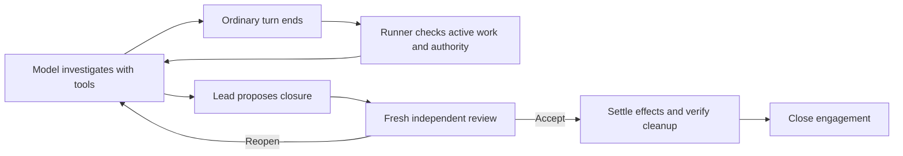
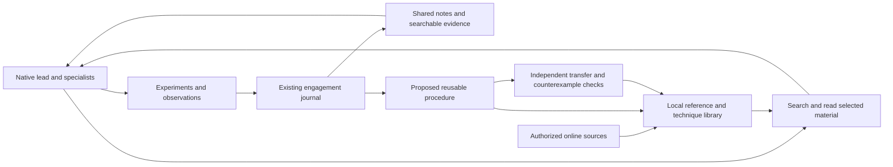

# OSLit research autonomy and knowledge reuse plan

Approved for implementation, 16 November 2026. The preceding engineering plan is closed by the operator. This plan extends the v2 implementation inspected at `95e5e0f1c01817c54cd4e137b990f9c663f1e960`; it does not reopen that plan's delivery work or change the meaning of its saved evidence.

The intended improvement is an investigation that changes direction from evidence without losing useful earlier work. A corrected assumption should reach the questions that relied on it. A weak effect should become discoverable when a later observation makes it relevant. A useful procedure learned in one engagement should be available to another, with its limits and supporting checks intact.

The existing native execution, shared evidence and independent review remain the foundation. First remove restrictions that confuse research judgment with enforceable facts. Then make existing shared notes easier to use and recover, and provide selective access to a useful knowledge library. Model routing, training, pricing and the operator's future fresh-target comparison remain separate decisions. The operator's latest correction explicitly reopens unnecessary requirements in the earlier implementation, without reopening that plan's entire delivery effort.

Supporting detail: [source lessons](oslit-research-autonomy-sources-2026-11-16.md) and [code integration map](oslit-requirements-deletion-map-2026-11-16.md). The operator approved implementation. [Decision 0016](../decisions/0016-research-autonomy.md) records the selected `research-autonomy-v1` policy; the working tree now contains its local implementation. Historical signatures keep their original behavior. The later 16 November verification authorization below supersedes the initial E2E/provider deferral; the [dated delivery report](../wiki/oslit-research-autonomy-delivery-2026-11-16.md) separates implementation and executed evidence. Fresh-target research and the native-agent comparison remain operator-owned.

## Selected direction

| Decision | Current direction |
| --- | --- |
| Threat-model revision | Agents may revise assumptions from evidence within the original signed scope. |
| Cross-engagement learning | Include evaluated reuse of techniques; keep target-specific evidence private and separate. |
| Candidate availability | Experimental techniques can be retrieved before evaluation. Recommended status requires independent checks. |
| Local and online knowledge | Support offline-capable local references and authorized online research. Initial reference-research authority may allow following newly discovered public sources. Offline operation is not compulsory. |
| Knowledge oracle starting point | Explicitly selected: keep the knowledge oracle, start with existing references and native search. Add specialized retrieval only when its benefit is supported. |
| Updates during research | Active engagements can search and read new knowledge on demand. Automatically save the selected version; do not silently replace it. |
| Reference retention failure | Selected on 16 November: deliver an otherwise permitted reference with a clear “not retained” status if saving fails, and continue research. Do not claim the exact contents are durably recoverable. |
| Evaluation scheduling | Agents select promising techniques for independent evaluation when likely to be reused. Saving and experimental use remain immediate; every note does not create another job. |
| Model selection | Deferred by the operator. Do not assume a permanent cheap-model swarm or a particular frontier model. |
| Effect of a changed belief | The lead reconsiders affected work; exploration remains available. Belief changes do not automatically block research. |
| Promotion | Automatic recommendation after independent transfer and counterexample checks for the exact version. Compare the library/retrieval method overall; reserve per-technique paired comparisons for doubtful or costly procedures. |
| Shared instructions | Automatic learning stays in the technique library. General-method and shared AGENTS.md changes are proposed separately. |
| Strategy disagreement | Remove automatic resource blocks and the fixed two-opportunity replacement counter. Deliver challenges; the lead chooses how to respond. |
| Scientific adequacy | Independent reviewers assess controls and reproduction. Code verifies actual identity, provenance, permissions and evidence integrity rather than a universal experiment shape. |
| Experiment order | Remove the universal self → stored → cross-user ladder. Follow granted effects and actual experiment prerequisites. |
| Adaptive research state | Ordinary shared notes, evidence search and existing team updates first. No dedicated dependency tracker or correction-resolution forms. |
| Native helper agents | Selected on 16 November: internal helpers share their parent's permissions and limits. Their work counts as the parent's work. Independent reviewers keep separate identities and fresh contexts. Preserve native features wherever possible. |
| Optional total limits | Selected on 16 November: total invocation and worker-time caps are optional. Enforce only operator-selected research limits. Keep the stop command, machine capacity controls and recovery from abandoned workers. No arbitrary research cutoff; existing signed limits keep their meaning. |

## Lessons that change the design

The KAIST POC 2026 slides support learning from both rejected and recovered candidates. They do not establish that their judge sequence is optimal: there was no ablation, and early filtered candidates were not independently revalidated. In the displayed verification sample, four of 45 human-confirmed bugs were missed by the system. Configuration changes, a different protocol sequence, a multi-file trigger and a virtual hardware substitute recovered them. The practical lesson is to retain why a route failed and what would change that conclusion. It is not to copy a fixed number of review rounds.

Anthropic's memory study supplies a related lesson: a false memory can make repeated encouragement prolong the wrong strategy. Source-backed correction helped in that example. Its document experiments also include both useful representations and representations that added little or grew larger than the sources. Preserve recoverable source material and keep derived context selective. [Components of agent memory](https://www.anthropic.com/research/components-of-agent-memory)

The workshop's strongest contribution is its comparison method: preserve the baseline's strengths and ties, and judge the resulting evidence rather than the polish of its report. For OSLit, that means a capable native baseline with its ordinary tools. Skills provide procedures; they do not supply deterministic execution. A factual query, a retrieved precedent and an observed effect have different roles. [Workshop comparison method](https://grahamhelton.github.io/harness-engineering-workshop-book/research-problems.html#how-we-will-approach-these-problems), [reusable skills](https://grahamhelton.github.io/harness-engineering-workshop-book/harness-components/reusable-skills.html)

Historical chains show why the unit of reasoning must be a conditional effect rather than a list of CVEs. Next.js illustrates deployment and provenance assumptions; curl shows a narrower protocol effect surviving a memory-safety mitigation; Nomad shows an upgrade changing the meaning of persistent state. These cases motivate the selected workflows. They are not evidence that a new graph representation improves OSLit. [Next.js postmortem](https://vercel.com/blog/postmortem-on-next-js-middleware-bypass), [curl advisory discussion](https://github.com/curl/curl-www/pull/308), [Nomad root-cause analysis](https://medium.com/nomad-xyz-blog/nomad-bridge-hack-root-cause-analysis-875ad2e5aacd)

Research on reusable procedures supports conditional transfer rather than universal instructions. Vul-RAG reports false positives when a different valid fix defeated its historical patch analogy. Several skill studies test a fresh session on the same source task; that does not establish transfer to a different project. A controlled negative experiment can teach a useful discriminator even when it produces no finding. [Vul-RAG](https://arxiv.org/html/2406.11147v3), [Demystifying Agent Skills](https://arxiv.org/html/2608.14036v1), [Learning by Doing](https://arxiv.org/html/2611.01386v1)

Finally, skill orchestration must remain removable. OpenAI reports a much smaller gain from a technique layer on a newer model and chose to remove the heavier orchestration. This is a bounded vendor experiment, but it supplies a concrete reason to compare each aid again after material model changes. [A thousand fewer paths to root](https://openai.com/index/a-thousand-fewer-paths-to-root/)

## What the implementation already provides

The current method already asks for revisable assumptions, serious alternatives, discriminating tests, compatible chains and retained unfinished work. Another paragraph telling the model to try harder would mostly repeat it. The implementation also provides immutable publications, source references and supersession, tasks, protected execution, instruments, evidence comparisons, fresh review, shared notices and recovery.

The gaps are narrower:

| Needed behavior | Existing support | Missing connection |
| --- | --- | --- |
| Reconsider work after an assumption changes | Publications, ordinary notes, source links and native notices | Recover useful current context and find corrections without compulsory dependency bookkeeping. |
| Revisit an old partial when a new condition appears | Durable observations and searchable board | Retrieve relevant unmet conditions and surviving effects at the current decision. |
| Use prior research in an isolated worker | Auxiliary support inputs and native file tools | A usable corpus, source-level retrieval and versioned active imports. |
| Reuse a learned procedure elsewhere | Versioned local instruments and measured experiments | A transferable package, library selection and applicability evaluation. |

The older casebook query is not a ready v2 library. It uses a separate admission contract, ranks whole lessons by token overlap and returns document introductions rather than matched passages. An empty response can conceal unavailable material. Preserve useful provenance and redaction checks, but do not inherit the old engagement state machine merely to reuse its search function.

## Long-horizon capability, persistence and evidence

The implementation already provides a real continuation loop. It does not yet have retained evidence that it conducts useful autonomous research for days or outperforms an equally equipped native agent. This is an evidence boundary, not a reopening of the preceding engineering plan. This map describes the inspected `95e5e0f1` baseline. The 16 November working tree implements the selected changes under a new policy; the baseline statements below are historical inspection findings, not claims about the revised code.

| Capability | Current mechanism | What remains uncertain or missing |
| --- | --- | --- |
| Continue after an ordinary answer | The runner records the completed turn and invokes the same native runtime again while its work remains active. | Another turn can repeat weak reasoning. Continuation alone does not establish useful progress. |
| Keep working through short worker lifetimes | Worker/environment permissions renew during an active turn. Compatible specialists can retain their session for another task. | Short renewal and session checks do not establish uninterrupted operation over days. |
| Recover useful prior work | The journal retains tasks, observations, scripts, evidence, reviews and usage; the board provides search. Resume reconciles receipts and can reconstruct eligible workers. | A resumed worker gets a new session but retains its delivery cursor. Earlier acknowledged work remains searchable without being automatically restored to its working context. |
| Recover from execution failures | Uncertain effects are reconciled before new ownership; public `resume` uses the same runner. | Many runtime exceptions exclude the failed generation and return `worker_progress_unavailable`. Internal session limits can take this path. Automatic safe recovery within the running command is incomplete. |
| End for a supported reason | The lead requests closure; a fresh reviewer accepts or reopens it. Goal-met closure requires confirmed claims, and broad goals must account for known unresolved tasks. Final closure also requires settled effects and cleanup. | Recorded task completeness is not completeness of all possible research. Omitted surfaces and weak negative conclusions require substantive reviewer judgment. |
| Change direction, build tools and connect effects | Native tools, task ownership, instruments, evidence comparisons, peer updates and method guidance support these activities. | Controlled execution checks do not demonstrate that a model discovers the useful next test, revisits an old partial or avoids an unsupported chain. The workflows below test those behaviors. |

The code paths are [continued turns and renewal](https://github.com/matheusht/redteam-harness/blob/95e5e0f1c01817c54cd4e137b990f9c663f1e960/tools/engagement_runner.py#L344), [recovery](https://github.com/matheusht/redteam-harness/blob/95e5e0f1c01817c54cd4e137b990f9c663f1e960/tools/engagement_runner.py#L159), [failed-worker handling](https://github.com/matheusht/redteam-harness/blob/95e5e0f1c01817c54cd4e137b990f9c663f1e960/tools/engagement_runner.py#L411), [new session with retained cursor](https://github.com/matheusht/redteam-harness/blob/95e5e0f1c01817c54cd4e137b990f9c663f1e960/tools/engagement_controller.py#L423), and [closure checks](https://github.com/matheusht/redteam-harness/blob/95e5e0f1c01817c54cd4e137b990f9c663f1e960/tools/engagement_evidence.py#L625).

Operator stop, selected limits, lost authority and unresolved operating failures can interrupt that flow. No completed model turn or elapsed research duration supplies a successful ending by itself.

The strongest retained joined runtime evidence here is the [hosted Codex/OMP workflow at `e93a4fd9`](https://github.com/matheusht/redteam-harness/blob/95e5e0f1c01817c54cd4e137b990f9c663f1e960/evals/native-qualification/team-evidence/codex-admission-20261115/README.md#hosted-native-run). It uses actual Linux containers and native runtimes, preserves conversation and files across two invocations, and checks revocation, recovery, export and cleanup. Its provider supplies predetermined responses; it is not model-directed research. Later shared-board and policy changes have local controlled evidence: [shared-state checks](https://github.com/matheusht/redteam-harness/blob/95e5e0f1c01817c54cd4e137b990f9c663f1e960/evals/native-qualification/team-evidence/nonpricing-completion-20261115/README.md) and [policy checks](https://github.com/matheusht/redteam-harness/blob/95e5e0f1c01817c54cd4e137b990f9c663f1e960/evals/native-qualification/team-evidence/autonomy-policy-20261115/README.md). Neither establishes multiday research quality. The [final handoff](https://github.com/matheusht/redteam-harness/blob/95e5e0f1c01817c54cd4e137b990f9c663f1e960/docs/agents/fresh-target-handoff.md#what-is-already-checked) retains live-model quality and long operation as operator verification; the [assembly record](https://github.com/matheusht/redteam-harness/blob/95e5e0f1c01817c54cd4e137b990f9c663f1e960/docs/research/oslit-implementation-assembly-2026-11-15.md#L252) records the fresh-target comparison as not run.

Instructions such as “do not take shortcuts” state the desired standard. Their useful content is concrete: follow promising leads, challenge assumptions with measurements, retain useful partials, complete the authorized workflow, and make a supported stopping decision. The [existing method](https://github.com/matheusht/redteam-harness/blob/95e5e0f1c01817c54cd4e137b990f9c663f1e960/engine/native-engagement-method.md) already asks for much of this. The frozen engagement method and invocation prompt are the delivery path; editing the repository's AGENTS.md alone would not update an existing engagement's frozen instructions.

Preserve the continuation loop and independent closure review while deleting the selected strategy vetoes and fixed replacement counter. Repair safe session continuation and context reconstruction in their existing owners. Reviewers assess whether important contrary evidence or promising unfinished work makes closure premature. Code enforces identity, permissions, actual records and reviewed state transitions; it cannot certify that the model thought hard enough or exhausted every possible surface. Minimum hours, tool-call quotas and another generic “try harder” loop would not supply that proof.

Judge efficacy by the executed research: recovering a useful earlier observation after interruption, revising a false premise, testing a valid connection, rejecting an incompatible one, and reaching an evidence-supported ending with less human steering. Include unsuccessful trials and justified negative conclusions. The failure-first workflows and matched comparisons below measure these behaviors. A sustained run separately measures operational continuity; duration alone is not research quality.

## System shape

The journal owns what happened in an engagement. The library owns immutable reusable packages and references to their evaluations. Search indexes and compact views are replaceable projections. They neither establish a vulnerability nor change authority. The native lead chooses the next experiment; there is no second permanent planner hidden inside a view.

Runtime independence means that goals, permissions and research records do not depend on Codex or OMP. An adapter connects each program's interface to the same OSLit controls. Shared code owns worker identity, permissions and evidence records. The test environment controls files, processes and network access. The adapter selects that environment, connects tools and reports session events. This does not require separate research rules for each runtime or a fork of its source code.

The inspected implementation restricts more than this definition alone requires: Codex disables built-in agent spawning, browser tools, plugins and web search; OMP disables automatic skills and default tools in the model process, then connects a separate tool process. These are current integration choices, not proven permanent product requirements. Prefer existing runtime settings and environment controls where they suffice. Add a runtime-specific block only for a named action that can evade the shared controls. No adapter should enforce a hypothesis, experiment order or use of a retrieved technique. The new library primarily needs content delivery and retained source versions.

Internal native helpers inherit their parent's OSLit identity, permissions and limits. They need no separate task assignment or OSLit worker record. The adapter must establish their actual relationship to the parent, include their use in the applicable shared limits and stop them with the parent. A copied parent name is insufficient. An internal helper cannot supply independent review of its parent's work. Reviewers remain separate workers with fresh contexts. Incomplete capture of ordinary intermediate work need not disable a permitted native feature; accepted claims still require inspectable decisive evidence.

Keep four meanings separate. Signed scope describes permitted research effects. The threat model describes observed or assumed attacker capabilities and system behavior. Diagnostic tools describe what the researcher can observe or arrange in a lab. Reporting criteria describe what counts toward the stated goal. A privileged diagnostic step can be useful without proving that an attacker has that privilege.

## 0. Delete requirements that do not earn their cost

These are selected corrections, not permissions to alter an existing engagement's frozen authority. Apply them through one new versioned policy and update affected callers and documentation together. Current replay uses the present reducer even for old frozen guidance, so immutable files alone do not preserve old behavior; verify compatibility explicitly. Startup, preflight, laboratory effect selection, review, completion and exports all need the same policy selection.

| Current restriction | Correction and retained boundary |
| --- | --- |
| A strategy challenge holds affected resources; two unanswered opportunities trigger lead replacement | Remove both, including any strategy veto left in completion checks. Keep challenges and disagreement visible. Actual loss of authority, uncertain effects, resource ownership and process recovery retain their concrete meaning. |
| A control must match conditions/accounts/effects; a reproduction must reuse identical probe bytes | Preserve actual records; let independent review judge the control and whether another reproducer establishes the same effect. Code binds declared conditions to the run; that alone does not prove the conditions held. The reviewer examines actual preconditions and cannot manufacture an execution receipt. |
| Every accepted review has the same five true checkboxes | Remove irrelevant universal checkboxes. Review the actual subject and cite supporting observations. |
| Effects must traverse self → stored → cross-user | Remove the generic ladder. Explicitly authorized effects may be investigated in a useful order. An operator-selected constraint or an actual state prerequisite still applies. |
| Every material test/correction/retry follows a multi-part writing template | Make useful advice optional. Preserve significant observations and results without requiring a form for every research choice. |
| The model manages global revision conflicts, extra request IDs, byte decoding and delivery acknowledgments | Move ordinary transport bookkeeping into existing adapter code. Keep concurrency checks for real conflicts, exact retries and bounded reads; remove needless conflicts on independent appended notes/messages. |
| Every run must provide total invocation and worker-time caps | Make these caps optional for new scopes. Enforce each limit the operator selects. Keep machine capacity controls and immediate operator stop. Session storage limits require continuation or recovery, not an invented research deadline. |

A missed hypothesis is not a permission violation. A researcher may run a useful in-scope experiment before it has a complete explanation, save an untested idea, adapt a skill, repeat a measurement or disagree with a reviewer. None of these choices changes what can honestly be called independently confirmed.

Absence of a total research limit does not mean unlimited machine capacity. Keep bounded queues, process/memory controls and short renewable worker permissions for failure recovery. Renewals must support continued authorized work. Internal session counters, certificate expiry or a full queue must not silently replace an omitted research limit. Preserve state and recover where possible; report an actual unresolved operating failure honestly.

Failure scenarios: a strategy dispute does not remove otherwise valid access; an unauthorized effect is still refused; an account-changing control and independently written reproducer reach review with their true conditions; a two-account test needs no unrelated persistence result; concurrent peer notes need no agent repair of a stale global revision. Define checks before changing implementation.

The always-loaded research guidance can fit in a short brief such as the following. Detailed tool usage belongs in discoverable tool help, and permissions are enforced by the runtime rather than a growing list of prompt warnings.

> Investigate the supplied goal within the granted scope. Choose the experiments and collaborators that help. Revise assumptions when observations change them, and keep useful partial results even when the original explanation fails. Share important evidence and enough working context to continue after interruption. Use prior techniques as advice that you may adapt or decline. Before calling a consequential finding confirmed, obtain independent examination of the actual effect, relevant control and reproduction. End with supported conclusions, remaining questions and the reason for stopping.

This is an illustrative replacement, not an additional mandatory prompt or a new format for each experiment.

## 1. Make useful research state easy to retain and recover

Use ordinary shared research notes and the existing journal, search and team updates. Agents choose how to describe assumptions, partial effects, unanswered questions and next experiments. A short note can be useful; no graph, taxonomy, dependency fields or correction dispositions are required.

Preserve original evidence and recover useful working notes after a restart. Correcting a belief does not rewrite the original observation. Competing explanations may coexist, and a different configuration need not supersede an earlier result. Notes provide context, not a second truth or authority store.

Most of this already exists: ordinary publications, correction references, full-body board search, team notices and export. A concrete recovery seam needs checking: `worker_resumed` clears the session/workspace but retains the old delivery cursor, and the new prompt requests updates after that cursor. Previously acknowledged notes remain searchable, but need not appear in the fresh context. Orient a new context from the current task and existing note/source links; do not reset delivery history, replay the whole journal or build a second memory service. A file left only in a worker's scratch directory is not automatically a shared note.

Make relevant updates easy to find and deliver through existing tools. Reading a notice does not prove understanding. The agent decides whether to continue, narrow, replace or defer work. Normal task/result/publication updates can preserve important choices; do not create an inbox of semantic obligations. Add task retirement only if the existing public workflow cannot retire work cleanly.

Failure-first workflow: an investigator learns an assumption is wrong; the correction is marked delivered by the transport. It then loses context, recovers the correction and evidence, and chooses a useful next test. Unrelated research continues; competing explanations remain available. Test the behavior without prescribing an internal representation or giving the recovered agent the answer. Only a demonstrated failure beyond ordinary notes/search would justify more structure.

## 2. Preserve partial effects and test the missing connection

A useful partial says what happened, under which conditions, and what remains missing for a larger claim. It may describe ordinary intended behavior, a measurement technique, an intermediate effect or an unresolved hypothesis. It need not be a confirmed vulnerability.

Allow short optional descriptions of what a partial provides, what a proposed connection needs, its known blocker and a reason to revisit it. Keep supporting observations and limits close to those descriptions. Do not require a fixed vulnerability taxonomy, numeric confidence, complete call graph or exhaustive form before exploration.

The agent can use notes and search to answer: which earlier effects might supply this missing condition, which apparently compatible effects conflict on identity, state, timing or version, and which narrower effects remain valid after a larger claim fails? Matching supplies leads. The investigator still has to reason about transitions and test the actual join. Different actors may compose through a demonstrated transition; exact actor equality would wrongly remove such paths.

A failed connection leaves its sound component observations available. A newly observed condition can reopen the connection without erasing the old negative. Repetition with only new wording or a fresh worker does not establish progress. Independent replay, repeatability checks, stochastic sampling and stateful sequence trials are legitimate repetitions when their measurement purpose is clear. A changed premise, better instrument or new discriminator can make a retry useful; this is advice, not a permission check or required explanation. A broad research goal can preserve an unexpected in-scope route even when it does not prove the original assigned hypothesis.

Failure-first workflow: the investigator discovers one weak partial, loses its working context, and later observes a condition that may make it useful. It must recover the partial and execute the connecting test. Include a plausible decoy that fails on lifetime, identity or state. Keep gold relationships out of the investigator's inputs. Prepared-record checks establish plumbing; an agent-discovered connection establishes the behavioral workflow.

A small owned test service can exercise this: an initial routing discrepancy has no cross-account consequence; an ordinary migration changes downstream state. Reuse the existing owned-application setup and reset path for this fixture. One hidden variant makes the earlier effect useful, while another retains an independent protection. Interrupt at the same allowance boundary, retain the investigator's actual notes and permit any valid research route. Count runs that miss the initial partial too. This tests whether a bounded negative wrongly erases a surviving effect, or whether the agent joins observations whose conditions do not coexist. Historical curl and Nomad cases motivate the scenario; it is not a reproduction of those exploits.

## 3. Deliver the knowledge oracle during active work

This is the reference-retrieval capability called a “truth oracle” in the original brief: find relevant research, fixes, techniques, prerequisites and counterexamples for the current question. The plan calls its content a source-backed library. Domain-specific collections can use the same search/read path; they do not require separate services. Measurement instruments establish what happened in the current environment, and independent review assesses what those observations support. Useful existing oracle cards and references can supply content without importing their old mandatory stages or treating a retrieved match as proof.

Begin with ordinary immutable files and a compact catalog. Keep original source identity and the relevant passage, not only a model-written summary. A technique may be a brief note, a procedure or a SKILL.md with optional helpers. Include material conditions, limits and evidence when known; saving an experimental idea needs neither a complete form nor prior successful execution. Native `SKILL.md` packaging is useful where supported, but file existence must not be confused with runtime discovery or execution.

Support both an offline snapshot and optional online research. Add a reference-web capability to new signed inputs that permits following newly discovered public sources under the initial grant, separate from target testing and provider access. Preserve old signatures and exact-origin contracts. Use the current acquisition and network mechanisms where their permitted methods and routes suffice. Search-provider access or native skill discovery that the current runtime profile disables needs explicit adapter/configuration work. Preserve the selected runtime's useful tools without enabling unrelated ambient plugins or treating retrieved instructions as authority.

Active workers search and read normally. The read/materialization path automatically attempts to retain the selected bytes and origin and, when needed, exposes helpers as working files. The adapter owns identities, retries and incomplete delivery; the researcher performs no import ceremony. New versions are discoverable during a run without silently replacing already-read content. A startup pack alone is insufficient because workers persist and startup registration closes after preparation.

Selected failure policy (16 November): if an authorized reference is available but durable retention fails, deliver it with an explicit “not retained” status and continue otherwise permitted research. Do not claim that its exact contents can be recovered later. Recommendation of an exact technique version still requires its retained package and evaluation evidence; finding confirmation still requires actual execution evidence. Content restrictions continue to apply. Distinguish failed reference storage from an unavailable source or an uncertain target effect. Exports must identify any retention gap instead of implying a complete source archive.

Start with a small useful offline reference pack and grow it through normal permitted research. Retain originals and searchable extraction; add summaries only when useful. Deduplicate identical bytes while retaining their origins, and preserve changed source versions. Refresh on demand first, with no background crawl or universal expiry requirement.

Initial material already exists under `skills/oracles/references/`: `ghsa-fix-diff-corpus.md`, `rejected-disputed-cve-corpus.md` and `project-zero-zdi-chain-corpus.md`. They offer fix mechanisms, counterarguments and stage transitions. Package them as searchable historical references with a short contents page; follow and retain primary sources when needed. Their excerpts and syntheses are not complete copies of every cited source. Preserve visible disagreements and correct known summary errors during packaging rather than inheriting old “verified” labels or legacy stage rules. Private engagement casebooks are not part of this default pack.

Use ordinary native file tools first. Native skill catalogs are a convenience, not a delivery prerequisite. Preserve selected content and actual helper bytes, not every catalog entry or ranking for each query. Detailed retrieval diagnostics belong in comparisons or investigation of a concrete failure.

The read path distinguishes an unavailable library, a query with no matches, partial results, a withdrawn version and an inaccessible private source. A selected source must remain inspectable beyond the snippet. Unknown compatibility is visible as a research question, not converted into a hard rejection.

Begin with capable native iterative search over an available corpus. If observed misses justify ranking, compare the smallest suitable passage-search improvement. Lexical and contextual/hybrid search are alternatives to investigate, not a mandatory implementation sequence. Exact terms, mechanisms and prerequisite caveats all matter; ranking cannot repair a missing corpus or a misleading summary.

Keep source retention and reading separate from finding publication. The current evidence object store has a 4 MiB limit and a scanner that rejects even some harmless public protocol examples; neither defines what reference material is useful. Support larger retained source files through bounded native reads and distinguish bare protocol syntax or unmistakably redacted/synthetic placeholders from actual credentials. Correct the shared scanner across storage, environment reads and native delivery; a public URL is no blanket exception, and actual credentials remain excluded. Preserve original-source and extracted-text identities, and report incomplete extraction or withheld content honestly. Withholding content after a completed read must not falsely imply an unknown physical execution.

Keep private corpus lookup local unless the engagement already grants the external processing involved. Public-reference queries can use public terms and mechanisms. An embedding service may receive documents, and a reranker may receive query text plus passages; enabling public web access does not silently authorize those private-data transfers. Express the selected boundary once in tool configuration and guidance, without per-query approval forms.

A lookup is a reference aid, not a truth oracle. It may retrieve a relevant historical technique while the present target uses a different valid control. The investigator may decline or adapt the suggestion and continue searching beyond it. A lack of retrieved precedent says nothing about the absence of an unknown vulnerability.

Failure-first workflow: a running worker finds and reads a selected source/helper; the adapter retains and materializes that version automatically, including after context or process interruption. While it runs, another engagement publishes a new version. A subsequent query can discover it, but the previously delivered version remains unchanged. Also interrupt the adapter between retaining the bytes and making them readable, then retry the normal read after a same-name catalog update. Recovery must deliver the originally selected version without claiming success early. Force reference-storage failure after a successful fetch: the worker receives the permitted content with “not retained,” continues useful work, and the export reports the gap. A later fetch must not be presented as the missing original version. Repeat with offline mode, an unavailable catalog, a same-name incompatible technique, a missing relevant precedent and a source whose condition was outside the initially matched paragraph.

## 4. Turn useful local work into evaluated reusable procedures

An engagement may save a technique or untested idea from source inspection, a positive result, a negative result or a new hypothesis. Preserve the actual procedure and its evidence; do not extract a universal rule from the model's own explanation of why a task succeeded or failed. A helper's correctness, a procedure's transfer and the benefit of recommending it are separate claims.

Make the note or package searchable as experimental so another authorized engagement can find it. Keep the original target evidence private. The transferred content should contain the general method, public or synthetic examples where useful, and supporting references that authorized evaluators can resolve. Shared library availability is not authorization for public publication.

Agents select promising candidates for evaluation rather than automatically scheduling every saved note. Use ordinary independent tasks with available authorized resources; the originating investigation need not wait. If the suitable case or environment is unavailable, the candidate remains experimental. No permanent evaluator service or separate per-note approval is needed.

Independently evaluate the exact version before recommending it. Check transfer to a changed case and a meaningful counterexample. One appropriate evaluation task can cover both. Use execution for measurement helpers and checkable decision outcomes for research procedures. Do not force every technique through a vulnerability-style effect/control/replay pipeline or evaluate it before every use. Avoid same-task replay masquerading as transfer; a different session or runtime on the same source problem is a narrower result.

The evaluation should test what the procedure helps determine. A diagnostic skill can pass by correctly establishing that a protection works. It should not fail merely because it produced no vulnerability. Conversely, a successful engagement does not prove that every step in a retrieved procedure helped.

Recommended status belongs to the exact package version and the supported applicability claim. A changed helper, changed procedure or broader claim needs its own evidence. A failed transfer can narrow the recommendation while preserving useful original work. Promotion is automatic after independent transfer and counterexample checks for that version. Comparative usefulness is assessed at the library/retrieval level; a separate per-technique benefit comparison is reserved for doubtful or costly procedures. Passing these checks supports the stated applicability, not universal superiority over native methods.

Later contrary evidence can narrow or withdraw an existing recommendation through ordinary independent evaluation. Preserve the version's bytes and earlier evaluations, and make the current status and reason visible on subsequent reads and through existing shared updates. This adds no automatic research block or reevaluation schedule.

Failure-first workflow: engagement A proposes a diagnostic procedure; active engagement B retrieves it as experimental, uses it under matching observed conditions and retains its exact bytes. An independent evaluation uses a different implementation with an alternative valid control. The procedure must recognize the difference or state what it cannot determine. A revised package does not inherit the old version's result.

## Integration scope

| Area | Changes the implementation must reach |
| --- | --- |
| Journal and tasks | Ordinary notes, source references, shared updates and recovery; task retirement only if missing. Preserve original evidence. |
| Board, status and notices | Existing search/updates; address demonstrated retrieval/delivery gaps. Adapter-owned bookkeeping keeps use simple. |
| Native delivery and recovery | Host tool schemas, Codex and OMP delivery, `engagement_read`/artifact paths, current view after recovery, active import and export provenance. |
| Knowledge packages | Versioned files, source passages, candidate status and evaluation references; derived catalog/search rather than a new authoritative database. |
| Local and online inputs | Existing support staging for selected startup material; a separate bounded active import path; permitted online search/read integration. Do not silently mutate startup support registration. |
| Evidence and exports | Reuse actual instrument/candidate/probe bindings and protected execution. Export delivered material and the records needed to reconstruct what was read or executed, without exhaustive catalog snapshots. |
| Guidance and public workflow | Short discovery/use instructions, CLI/tool examples and failure-first E2E scenarios. Avoid adding all technique content to always-loaded guidance. |

Important source seams are `tools/engagement_controller.py`, `tools/engagement_board.py`, `tools/engagement_runner.py`, `tools/engagement_native_boundary.py`, `tools/engagement_evidence.py`, `tools/research_environment.py`, the runtime adapters, and the frozen method/protocol guidance. The implementation must trace their public callers and exports before changing schemas.

## Delivery and evidence

Implement one complete workflow at a time. First define its failure scenarios and expected observable result, then make the smallest code change that satisfies them. Retain repeatable inputs, commands, environment requirements and saved outputs. Do not count a field, notice or revised Markdown file as proof that the agent changed its experiment.

Suggested order:

1. Remove selected restrictions and shorten always-loaded guidance.
2. Complete ordinary notes/search/update recovery and partial-effect rediscovery.
3. Deliver local/online knowledge during active runs with automatic version retention.
4. Add experimental reuse and independent evaluation for recommendation.

Knowledge access can be developed alongside the first two workflows. A deterministic check establishes storage/delivery behavior; a real native run in each runtime claimed as supported establishes that those adapters use the path; a matched research comparison establishes benefit. Experimental use can begin before a general benefit claim. Recommending one evaluated technique is also separate from showing that a custom retriever improves whole investigations.

For a benefit claim, compare the same capable native agent with the same sources, tools and total allowance. Separate the value of supplying knowledge from the value of its retriever, then from the value of a learned procedure when the outcome is ambiguous. Retain unsuccessful trials and human interventions. A whole-harness comparison gives the native baseline the same accepted reusable instructions as well as the same raw sources. In an isolated procedure experiment, the new procedure is deliberately the treatment and is frozen before held-out cases. Do not give the treatment a hand-authored chain or answer key that the baseline lacks.

A small first comparison can resume the same research checkpoint in fresh sessions: normal native tools; those tools with an added source pack; then the same source pack with a learned procedure. The first difference tests supplying knowledge, and the second tests the procedure. All three retain normal independent search and the same useful feedback. Compare the first material experiment actually executed and its interpretation, including justified decisions to stop or change direction. The later chain/recovery scenario tests a longer sequence. Choose a few relevant controlled cases and retain repeated-run disagreements; a fixed large benchmark is not a prerequisite to experimental library access.

Measure the next executed test, recovered valid connections, missed viable routes, obsolete-assumption reuse, unsupported joins, repeated nondiscriminating work and human steering. Count preparation, retrieval, evaluation and maintenance work. Retrieval hits, skill invocations, graph size and a lower volume of reported candidates are diagnostics, not the objective.

Known controlled cases can establish the new behaviors and expose regressions. They cannot establish general zero-day discovery or exhaustive safety. The later fresh-target comparison remains the operator's separate test.

## Keep the system able to improve with its models

The durable assets are source evidence, tested conditions, portable procedures and repeatable outcome checks. Working summaries, retrieval ranking and procedural scaffolding should be replaceable.

Keep a cheap comparison path with augmentation disabled while retaining the same source pack, ordinary journal, native search and evidence controls. Model upgrades are an opportunity to revisit additions with the few relevant cases, not a mandatory reevaluation of every stored technique or a reason to block ordinary research. Remove an aid when native behavior achieves the intended outcome with less material work or when the aid repeatedly causes false exclusions, unsupported connections or needless procedural adherence.

Do not regenerate immutable history, permission enforcement or accepted interfaces merely because a new model is better at writing code. Use versioned goals and outcome checks to make implementation replaceable, then verify any replacement. A maintained prompt is useful specification; it is not execution evidence.

## Work to leave out

Do not add a graph database, universal vulnerability ontology, permanent semantic planner, fixed swarm, general false-positive judge, per-skill evaluator service or always-on memory-consolidation process. Each would need a concrete failure that the smaller design cannot handle. Do not use a retrieval miss as a stopping rule, demand a stronger primitive when a weaker one can satisfy the goal, or make an experimental skill mandatory because it happens to rank first.

The core product choices for this phase are selected; model routing is deliberately deferred. Native helper ownership, optional total limits, the knowledge-oracle starting point and continued reading with “not retained” status are settled. The operator completed that review and authorized implementation, as recorded below. Exact field names, file layout and search libraries are implementation choices unless they change those behaviors.

## Initial implementation authorization, 16 November 2026

The operator confirmed shared understanding and authorized Astra to implement the full plan, reusing PRs #221–#223. Luna owns minimal verification. Full E2E, provider runs and research comparisons remain deferred until explicitly requested. Selective formal verification is an optional engineering aid, not a runtime feature or universal gate. No Omega proposals are included.

The operator selected ten minutes for a parent and two helpers running concurrently for ten minutes: the optional shared budget uses elapsed parent-session time, not summed helper time. Keep helper activity and actual provider usage visible without charging their overlapping duration again. Historical scopes retain their original accounting. No cap is introduced when omitted.

Define failure cases before implementation. Reuse existing small checks and add only focused checks necessary for changed nontrivial behavior; do not run full E2E. Report implementation, local checks and deferred verification separately.

## Initial local implementation update, 16 November 2026

The working tree contains policy-selected guidance/defaults, advisory strategy
handling, independent scientific review over retained execution facts, optional
totals, native helpers, current-context recovery, and the active reference/technique
library. See [Decision 0016](../decisions/0016-research-autonomy.md), the
[operator guide](../agents/engagement.md) and [library guide](../agents/knowledge-library.md).
These are local implementation facts, not a deployment, provider qualification or
research-benefit result. Luna's focused prewritten knowledge check passes; corpus
search returns available results. Native materialization, full E2E, provider runs,
sustained operation and research comparisons remain unverified/deferred. The
[preimplementation failure cases](knowledge-library-failure-cases-2026-11-16.md)
remain the verification contract; no historical result was rewritten.

## Subsequent verification authorization, 16 November 2026

The operator subsequently requested full E2E now: Terra repairs missing dependencies,
rebuilds runtime images and exercises the complete workflow in Codex and OMP; Astra
handles implementation fixes. The operator also requested a PR and progress across
all implementation areas. This supersedes the initial limited-check instruction
and E2E/provider deferral above. It does not authorize a merge or replace the
operator-owned fresh-target investigation and fair native-agent comparison.

The [dated delivery report](../wiki/oslit-research-autonomy-delivery-2026-11-16.md)
records current source, local checks, hosted native mechanics, live-provider
observations and unresolved limits separately. Historical execution records and
signed engagements remain unchanged.

## Completed bounded verification, 16 November 2026

The implementation is complete in the candidate branch. Hosted run
[43934112061](https://github.com/matheusht/redteam-harness/actions/runs/43934112061)
passed both native public workflows through fresh review, closure, verified export
and cleanup at `0983d8b1`, alongside both direct native suites and the Docker job.
The [delivery report](../wiki/oslit-research-autonomy-delivery-2026-11-16.md) retains
the exact local/hosted evidence and incomplete compaction-interval accounting.
These controlled provider workflows do not establish fresh-target research benefit,
a fair native-agent advantage, useful multiday research or whole-team live-provider
qualification. Those evidence boundaries remain unchanged.
